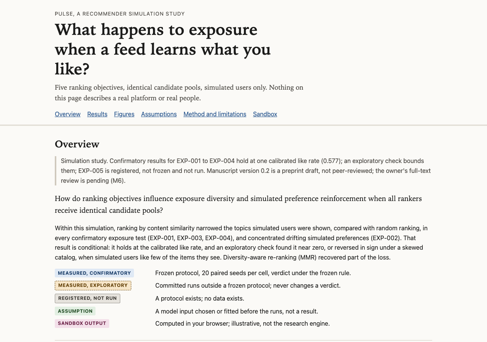

<!-- SPDX-License-Identifier: LicenseRef-PULSE-NC-Research-1.0 -->
# PULSE: recommendation feedback and attention (simulation study)

**Question.** How do ranking objectives influence exposure diversity and simulated preference reinforcement when all rankers receive identical candidate pools?

**Status (2026-11-25).** Simulation study. Confirmatory experiments EXP-001 to EXP-004 are complete (1,260 runs, 0 failed) under a protocol frozen by the owner before execution; they hold at one calibrated like rate. An exploratory check bounds them. EXP-005 (like-rate dependence) is registered, not frozen and not run. Manuscript version 0.2 is an independent preprint draft, not peer-reviewed; the owner approved its title and statements, and the owner's full-text review is pending (M6). Nothing has been published.



## Why it matters

Recommender systems learn from feedback on the items they themselves chose to show. Prior simulation studies report that such loops can narrow exposure and amplify preferences, but they use different simulators and assumptions. PULSE isolates the ranking objective: five rankers (random, popularity, content similarity, a LinUCB bandit and MMR diversity-aware re-ranking) receive the same catalog, simulated users, candidate pools and noisy feedback, and are compared with random ranking with seed-level uncertainty. It is a simulation: it makes no claim about real platforms, real users, attention or addiction.

## Key results (verified; identical to the manuscript)

All values are simulated, mean paired differences over 20 seeds with 95% paired t-intervals, from `research/paper/manuscript.md` sections 5.1 to 5.5.

| Experiment | Label | Result | Verdict under the frozen rule |
| --- | --- | --- | --- |
| EXP-001, static preferences | confirmatory | Similarity minus random in exposure topic entropy H_exp: -0.4000 [-0.4028, -0.3972] | H1 supported in all four cells |
| EXP-002, drifting preferences | confirmatory | Similarity minus random in Delta H_pref: -0.4350 [-0.4387, -0.4313] | H1 supported in all four cells; drift-form check weak |
| EXP-003, catalog skew and choice sharpness | confirmatory sensitivity | Zipf, tau 0.1: -0.5060 [-0.5169, -0.4951] | H1 supported; invalidation criteria not met |
| EXP-004, MovieLens-derived preferences and catalog | confirmatory second test | -0.4095 [-0.4210, -0.3980] | H1 supported |
| XPL-M4-LIKERATE, like-rate dependence | exploratory, post hoc, 5 seeds | Uniform catalog at like rate 0.02: -0.0032 [-0.0051, -0.0013]; Zipf catalog at 0.02: +0.1045 [0.0925, 0.1165] | no frozen rule; changes no verdict |
| EXP-005, like-rate dependence | registered, not frozen | no data | not run |

The popularity ranker barely changed topic entropy (-0.0089 [-0.0115, -0.0064], below the smallest effect of interest of 0.05) while it concentrated item exposure most. MMR re-ranking recovered between 45% and 79% of the exposure-entropy loss across cells, at a small cost in relevance. The narrowing is a conditional property of this simulation at the calibrated like rate of 0.577, not a general law of similarity ranking.

## Research navigation

- Manuscript: `research/paper/manuscript.md` (canonical Markdown; PDF not yet built, M6) and `research/paper/supplementary.md`.
- Experiment reports: `research/experiments/EXP-001/report.md` to `EXP-004/report.md`; EXP-005 protocol draft: `research/experiments/EXP-005/protocol.md`.
- Registry `research/experiment_registry.csv`, claims register `research/claims_register.csv`, evidence manifest `research/publication/artifact_manifest.json`, limitations `research/limitations.md`, decisions `research/decision_log.md`.
- Article drafts (unpublished): `articles/medium.md`, `articles/linkedin.md`.

## What is implemented

- `src/pulse/`: synthetic world and MovieLens-derived inputs, interaction loop with common random numbers, five rankers, metrics, paired statistics, versioned result schema, run manifests, freeze guard, runner, report generator and CLI.
- `tests/`: 161 Python tests (unit, golden, property, differential, integration, freeze guard, demo export consistency).
- `demo/`: static offline page (React and Vite, pinned) that shows the published results from `demo/public/data/results.json` and a sandbox with two simulated feeds side by side. The sandbox is a TypeScript port of the loop, checked against the Python engine on recorded random inputs, but it uses a different random-number generator and a smaller world: it is illustrative, not the research engine.

## Quick start

```
/Users/bechir/research/labs/.tools/py/bin/uv sync --frozen --all-groups --all-extras
.venv/bin/python -m pytest -q
```

Demo (Node 22 and npm; no account, no network after the first load):

```
cd demo && npm ci && npm run build && npm run preview
```

## Full reproduction

```
PYTHONPATH=src .venv/bin/python -m pulse.cli run --experiment EXP-00N        # N = 1 to 4; refused unless the config matches the freeze record
PYTHONPATH=src .venv/bin/python scripts/analyse_experiment.py EXP-00N
PYTHONPATH=src .venv/bin/python scripts/m4_evidence_audit.py
.venv/bin/python scripts/export_demo_data.py                               # demo results file from committed results
```

EXP-004 needs the MovieLens 1M files, regenerated by `scripts/download_movielens.py` and `scripts/prepare_movielens.py` and checked by SHA-256. The confirmatory matrices took about 19.5 minutes on an Apple M1 Pro.

## Data and licences

Synthetic data except MovieLens 1M (GroupLens, Harper and Konstan 2015), used under its research licence for calibration and EXP-004: not redistributed, no commercial use, no endorsement by the University of Minnesota or GroupLens stated or implied; only aggregates are committed. See `data/manifest.json`.

## Limitations

Simulation only; every confirmatory result holds at one calibration and the effect disappears or reverses at low like rates in an exploratory check; the primary direction was expected by construction; user control and relevance are narrow operationalisations; the drift-form check is weak. Full list: `research/limitations.md`.

## Licence

PULSE Source-Available Non-Commercial Research License v1.0 (`LICENSE`, `NOTICE.md`). This is a custom licence, not an OSI open-source licence. Third-party material keeps its own terms.

## Citation

See `CITATION.cff`. Repository and demo address: [to be added by the owner on release].
