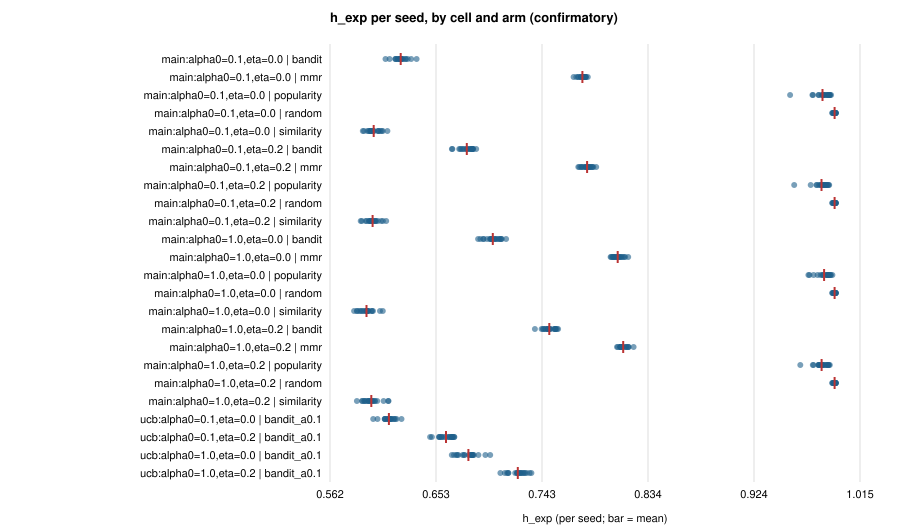

<!-- SPDX-License-Identifier: LicenseRef-PULSE-NC-Research-1.0 -->
# EXP-001 report: ranking objective and exposure diversity under static preferences

**Label: CONFIRMATORY. Status: complete (480 of 480 planned runs, 0 failed, 0 excluded). Verdict under the frozen rule: H1 supported.**

## 1. Identification

| Item | Value |
| --- | --- |
| Experiment | EXP-001, protocol v1.0 (frozen 2026-11-24, owner-approved, D-012) |
| Report date | 2026-11-25 (M3). Written after the run from the committed results, tables and figures only (owner decision D-015) |
| Authorship | Mohamed Bechir Kefi (no affiliation; owner decision C3). An AI system acted as research and development assistant; it is not an author. |
| Protocol SHA-256 | `fbb70fc9d461e339f731ed3b928d024586d460a82543dec287edfbb7e7a38b20` (main protocol `87fbfae1016c543f9736828d8e17d7015d42b894e62886eb798f38e3d8fcb12c`) |
| Config | `experiments/EXP-001.json`, file SHA-256 `510dcc30b6b955ad4aaf8b262d8936a5b419d125b540293c8319f212cddc6fc4`, canonical SHA-256 `e51281119eed3c3bcd8ce8042cadc37b104c9b670d4992574e1d2b1095b7afcc` |
| Code revision | `f1838f3e8451c8c4275579a5736fe488354a8f3a` (clean tree for every run) |
| Machine-readable outputs | `results/raw/EXP-001/` (480 run files, `set_manifest.json`, `result_schema.json`), log `results/raw/logs/EXP-001.log`; in this folder `verdict.json`, `metrics.csv`, `summary.csv`, `contrasts.csv`, `run_manifest.json`, `runs.csv`, `config.json`, `tables.md`, `figures/` |
| Supporting code | `src/pulse/` (simulator, rankers, metrics, stats), `src/pulse/analysis.py` (frozen decision rule), `scripts/analyse_experiment.py`, `scripts/report_tables.py` |

## 2. Executive summary

- **Question.** With static simulated preferences and identical candidate pools, how much does each ranking objective change final-window exposure topic entropy H_exp relative to random ranking?
- **Method.** 5 rankers x feedback noise eta {0.0, 0.2} x initial concentration alpha_0 {1.0, 0.1} x 20 paired seeds, plus 80 LinUCB runs at alpha_ucb = 0.1. The choice curve was calibrated before the freeze to a MovieLens target like rate (c = 0.066421, tau = 0.1).
- **Outcome.** In the primary cell (eta 0.0, alpha_0 1.0), content similarity changed H_exp by -0.4000 relative to random (95% paired t-interval [-0.4028, -0.3972], 20 seeds). That is eight times the smallest effect of interest (0.05).
  - The same contrast lay between -0.3938 and -0.4000 in all four cells.
  - The bandit and MMR arms also lowered H_exp.
  - Popularity changed H_exp by only -0.0089, below the smallest effect of interest.
- **Principal caveat.** The direction was expected by construction (protocol section 3). The result is a property of this simulation under its stated assumptions. It is not a measurement of any real platform or person.

## 3. Rationale and literature

- **Prior work.** Simulation studies report homogenisation from recommender feedback loops (Chaney et al. 2018, arXiv:1710.11214) and amplification of popularity bias (Mansoury et al. 2020, arXiv:2007.13019). Exploration is discussed as a mitigation of degenerate feedback loops (Jiang et al. 2019, arXiv:1902.10730).
- **Gap addressed.** This experiment is a matched comparison. Five rankers receive the same candidate pools, the same users and the same noisy explicit feedback, so differences in exposure diversity can be attributed to the ranking objective.
- **Access dates.** In `research/literature_review.md`.

## 4. Hypotheses and operational definitions

- **Primary metric.** H_exp(u) = -sum_z q_uz ln q_uz / ln K.
  - q_u is the distribution of primary topics of the items shown to user u in the last W = 50 steps, weighted by the examination probability beta^(j-1) (beta = 0.85, position j).
  - Run value: mean over U = 200 users.
  - Unit: normalised entropy in [0, 1]. Lower means less diverse exposure.
- **Contrast.** Delta = H_exp(similarity) - H_exp(random), paired by master seed.
- **Hypotheses.** H0: E[Delta] = 0. H1: E[Delta] < 0 in the primary cell (eta 0.0, alpha_0 1.0).
- **Disconfirmation (frozen).** H1 is not supported if the upper bound of the 95% paired t-interval is >= 0, or if the point estimate is above -0.05 (no practically relevant reduction).
- **Secondary contrasts.** The same contrast in the other three cells; popularity, bandit and MMR against random; MMR against similarity.
- **Secondary metrics.** Gini of item exposure, relevance, miscalibration KL (Steck 2018), user control (arm minus random only, protocol 15.7) and like rate.
- **Multiplicity.** Holm adjustment within each cell and metric family: five contrasts, or four for user control.
- **Controls.**
  - Common random numbers: catalog, users and candidate pools are identical across arms for a given seed.
  - All rankers see only the observed (noisy) feedback.
  - One seeded tie rule applies to all rankers.

## 5. Methodology

- **Model.**
  - K = 10 topics.
  - N = 1000 items with embeddings normalise(onehot(z_i) + N(0, 0.3^2 I)).
  - U = 200 users with p_u(0) ~ Dirichlet(alpha_0 1_K) and static preferences.
  - T = 200 steps.
- **Interaction loop.**
  - At each step, a pool of C = 50 items is drawn uniformly without replacement, and the ranker returns a slate of k = 10.
  - The user examines position j with probability beta^(j-1) and likes an examined item with probability sigmoid((r_ui - c)/tau).
  - Observed feedback is flipped with probability eta.
- **Rankers.**
  - Random.
  - Popularity: global like counts.
  - Content similarity: cosine to the profile of liked minus disliked embeddings.
  - Per-user LinUCB (Li et al. 2010): alpha_ucb 1.0 in the primary family, 0.1 as the nested level (block `ucb`).
  - MMR (Carbonell and Goldstein 1998), lambda 0.5.
- **Calibration.**
  - c = 0.06642147188540548 for tau = 0.1.
  - Fitted before the freeze to the MovieLens 1M calibration-half like rate L* = 0.577143, without any ranker or metric (protocol 15.5; journal CAL-ML1M).
  - Check: in the random arm at alpha_0 1.0 and eta 0.0, the observed like rate was 0.5770 (SD 0.0024, Table A).
- **Data.** Users and items are synthetic. MovieLens enters only through the fitted constant c.
- **Design.** Seeds 101001 to 101020 (20 per cell).
  - Block `main`: 5 x 2 x 2 x 20 = 400 runs.
  - Block `ucb` (bandit at alpha_ucb 0.1): 4 cells x 20 = 80 runs.
  - Total: 480 runs.
- **Statistics.**
  - For each contrast: mean paired difference over seeds, 95% t-interval, percentile bootstrap (10,000 resamples, seed 20261124) as a check, d_z, and per-seed values (`metrics.csv`).
  - Seeds are the experimental unit. Users and steps are never treated as independent.
- **Software and hardware.**
  - Python 3.12.1 and numpy 2.3.5 on macOS 15.3.1, Apple M1 Pro (10 cores, 16 GiB).
  - One process under `nice -n 10`, in parallel with EXP-002 (two worker processes in total).
- **Budget.** At most 1.5 hours allowed; 904.6 s of wall clock used.

## 6. Implementation verification

- **Test suite before the run.** 153 passed, 0 failed. Coverage includes:
  - golden values for entropy, Gini (also against the O(N^2) definition), KL, t quantiles (df 1, 2, 9, 19, 30), the paired summary and Holm;
  - seed determinism, tie rules and zero-feedback behaviour;
  - H_exp against a naive loop.

  Journal entry: XPL-M3-METRICS.
- **Smoke run.** Rerun at the provenance revision on exploratory seeds 900001 to 900002 (journal XPL-M3-SMOKE). All 10 runs were ok, and every metric value was identical to the M2 smoke set.
- **Run guard.** `pulse.runner.freeze_check` accepted the frozen config; every frozen hash matched.
- **Invariants.** The simulator's built-in invariant checks raised no error in any run.
- **Faithfulness check.** The random arm's H_exp (0.9932) is close to the pool topic entropy (0.9983, Table E), as expected for a ranker that ignores feedback. Its value is identical across the eta cells, because it never reads feedback and the pools are common random numbers.

## 7. Execution record

- **Command.** `nice -n 10 env PYTHONPATH=src .venv/bin/python -m pulse.cli run --experiment EXP-001`.
- **Timing and resources.**
  - Start 2026-11-24T23:33:55Z, end 2026-11-24T23:49:00Z (UTC).
  - Wall clock 904.6 s.
  - Peak resident memory 132,562,944 bytes (whole process).
  - Exit status 0.
- **Runs.** 480 planned, 480 executed, 480 ok, 0 failed, 0 excluded, no retry.
- **Provenance.** `run_manifest.json` and `runs.csv` record, for each run: id, config hash, seed, revision, data-manifest hash, hardware, start and end times, and status. `run_manifest.json` (`raw_sha256`) also holds the SHA-256 of every raw file.
- **Deviations from the frozen protocol: none.**
  - The decision-rule code was committed before any confirmatory output (D-013).
  - The reproduction-command text in protocol section 15 is outdated (freeze record, "not_applied"). The working commands are in `reproduction.md`.
  - The report was written after the run, not while the experiment finished. The file tool refused report files in the run session, and the owner then approved writing them from committed results only (owner, 2026-11-25, "approve all recommendations, RIGGED A"; D-015).

## 8. Results

All numbers below are copied from `tables.md`:
- Table A: per-arm means and SD over seeds.
- Table B: all paired contrasts for every metric, with t and bootstrap intervals and Holm p-values.
- Table C: the frozen decision rule.
- Table E: run diagnostics.

**Primary contrast and the same contrast in the other cells (Tables B and C).**

| Cell | Delta = H_exp(similarity) - H_exp(random) | 95% t-interval | 95% bootstrap | d_z | Frozen rule |
| --- | --- | --- | --- | --- | --- |
| eta 0.0, alpha_0 1.0 (primary) | -0.4000 | [-0.4028, -0.3972] | [-0.4025, -0.3974] | -67.47 | H1 supported |
| eta 0.0, alpha_0 0.1 | -0.3938 | [-0.3963, -0.3913] | [-0.3960, -0.3915] | -74.54 | H1 supported |
| eta 0.2, alpha_0 1.0 | -0.3959 | [-0.3991, -0.3927] | [-0.3988, -0.3928] | -57.30 | H1 supported |
| eta 0.2, alpha_0 0.1 | -0.3948 | [-0.3974, -0.3922] | [-0.3971, -0.3922] | -71.96 | H1 supported |

Absolute levels in the primary cell (mean over 20 seeds, SD in parentheses): random 0.9932 (0.0009), similarity 0.5932 (0.0062). The SD of the paired differences was 0.0059 (`contrasts.csv`).

**H_exp of every arm against random, primary cell (Table B).** Every Holm-adjusted p < 0.0001.

| Contrast | Mean | 95% t-interval |
| --- | --- | --- |
| popularity - random | -0.0089 | [-0.0115, -0.0064] |
| bandit - random | -0.2920 | [-0.2950, -0.2891] |
| mmr - random | -0.1853 | [-0.1873, -0.1834] |
| mmr - similarity | 0.2147 | [0.2125, 0.2169] |

The popularity contrast is negative and its interval excludes 0, but it is smaller than the smallest effect of interest (0.05). In practical terms it is a null result. The same holds in the other three cells (-0.0103 to -0.0112).

**Secondary metrics, primary cell (Table B; mean paired differences).** Holm-adjusted p < 0.0001 unless a value is stated.

| Contrast | Gini | relevance | miscal. KL | user control | like rate |
| --- | --- | --- | --- | --- | --- |
| popularity - random | 0.7308 | 0.0003 (p Holm 0.0022) | 0.0188 | 0.0033 | 0.0003, 95% t [-0.0003, 0.0009], p Holm 0.3289 |
| similarity - random | 0.1539 | 0.0603 | 0.1823 | 0.0120 | 0.1283 |
| bandit - random | 0.1727 | 0.0536 | 0.1452 | 0.0054 | 0.1151 |
| mmr - random | 0.0915 | 0.0503 | -0.1874 | 0.0399 | 0.1077 |
| mmr - similarity | -0.0624 | -0.0100 | -0.3697 | not computed (protocol 15.7) | -0.0207 |

- **Intervals.** The intervals for every entry are in Table B.
- **Popularity like rate.** Popularity did not differ from random in like rate: the interval includes 0.
- **Reading user control.** The metric is negative for every arm, with a random reference level of -0.0892 (Table A). A positive arm-minus-random value means that, after a dislike, slates moved away from the disliked topic less than they do under random ranking.

**Nested bandit level (descriptive only; no frozen test, D-013).**
- Primary cell (Table A): H_exp was 0.6803 (SD 0.0086) at alpha_ucb 0.1 and 0.7012 (SD 0.0065) at alpha_ucb 1.0.
- The lower exploration level also gave the lower H_exp in the other three cells: 0.6124 vs 0.6224, 0.6611 vs 0.6789, and 0.7225 vs 0.7494.

**Figures.**

## 9. Interpretation

- **Expected vs observed.** The protocol expected a reduction by construction (section 3). The observed reduction (-0.4000) is far beyond the smallest effect of interest. It was stable across feedback noise and initial concentration: similarity reached an H_exp between 0.5932 and 0.5994 in every cell (Table A).
- **Measured vs model-dependent.**
  - Measured: in this simulation, with static preferences and matched pools, the similarity ranker narrowed topic exposure.
  - Model-dependent: the size of the effect depends on the embedding geometry (one dominant topic per item), the slate and pool sizes, and the choice curve. EXP-003 tests pool skew and choice sharpness. EXP-004 tests MovieLens-derived preferences.
- **Trade-offs.**
  - Similarity also gave the highest relevance and like rate of all arms. In this model, narrowing came with higher measured relevance.
  - MMR recovered about half of the entropy loss (MMR minus similarity +0.2147). It cost a little relevance (-0.0100) and like rate (-0.0207), and it lowered miscalibration relative to random (-0.1874).
  - Popularity concentrated item exposure strongly (Gini +0.7308) while leaving topic entropy almost unchanged. Topic entropy and item concentration measure different things.
- **User control.**
  - Every non-random arm responded less to a dislike than random ranking did. MMR, which diversifies slates the most, had the largest value (+0.0399).
  - Random slates change topic shares mechanically from step to step, so this narrow metric partly measures slate volatility (limitations item 13).
  - It is reported as measured, not as a statement about user agency.
- **Literature.** The direction agrees with simulation reports of homogenisation (Chaney et al. 2018). The contribution here is a matched-pool effect size, not a new phenomenon.
- **Alternatives.**
  - Candidate-pool composition: excluded within a seed by common random numbers, and tested across catalogs in EXP-003.
  - Feedback noise and initial concentration: varied as factors here, with no change in the conclusion.
- **Evidence.** The result supports H1 under the frozen rule.

## 10. Threats to validity

- **Internal.** Matched pools and common random numbers remove differences in pool composition between arms within a seed. Tests and invariant checks guard against implementation errors, but an undetected defect in a ranker remains possible.
- **Construct.**
  - H_exp counts only an item's primary topic.
  - User control is a narrow operationalisation (limitations 5 and 13).
  - Relevance uses the true latent utility, which no real system observes.
- **Statistical.**
  - With 20 seeds the intervals are narrow, because seed-level variation is small.
  - Large d_z values follow from that small variation, not from a large effect on a human-meaningful scale (limitations 14).
  - The frozen smallest effect of interest is the relevant threshold.
- **External.**
  - Users have Dirichlet preferences and the catalog is uniform.
  - EXP-004 repeats the primary contrast with MovieLens-derived preferences and catalog weights.
  - No claim is made about any real platform, real users or addiction.
- **Calibration.**
  - The target like rate comes from selected exposure in MovieLens (limitations 9).
  - The recalibration was motivated by an exploratory observation, made while exploratory primary values under the earlier midpoint had been seen (freeze record C4).
- **Hardware.** Runs shared the machine with EXP-002 (two processes). Runtime is recorded but is not a result of this experiment.

## 11. Conclusion and next experiment

Within this simulation, content-similarity ranking lowered final-window exposure topic entropy by 0.4000 (95% t-interval [-0.4028, -0.3972]) relative to random ranking with matched pools. H1 is supported under the frozen rule.

A possible follow-up would vary the embedding noise sigma_item, which controls how strongly a similarity profile concentrates on a single topic. It would need a new experiment id and would remain exploratory until frozen.

## 12. Reproduction appendix

See `reproduction.md` in this folder for the exact commands.

- **Dependencies.** `uv.lock` (numpy 2.3.5, pytest 8.4.2), Python 3.12.1.
- **Data.** Data manifest `data/manifest.json`, SHA-256 `296b1edc9522d06275b20fc29fae08b0fc0405f880cf81fc9174ee26699a9fc0`, checked by the run guard. This experiment reads no real data file.
- **Raw results.** `results/raw/EXP-001/runs/*.json`, schema `pulse.run_result` 1.0.0 (`result_schema.json`). Checksums are in `run_manifest.json`.
- **Tolerance.** The simulation is seeded. A rerun on the same platform and numpy version is expected to reproduce every metric exactly; the smoke matrix did so across revisions. Other platforms may differ in the last floating-point digits.
- **Figures and tables.** Regenerated from the raw files by `scripts/analyse_experiment.py` and `scripts/report_tables.py`.
- **References.** Full entries are in `research/paper/references.bib`.
  - Chaney et al. 2018 (arXiv:1710.11214).
  - Mansoury et al. 2020 (arXiv:2007.13019).
  - Jiang et al. 2019 (arXiv:1902.10730).
  - Li et al. 2010.
  - Carbonell and Goldstein 1998.
  - Steck 2018 (doi:10.1145/3240323.3240372).
  - Harper and Konstan 2015 (doi:10.1145/2827872).
