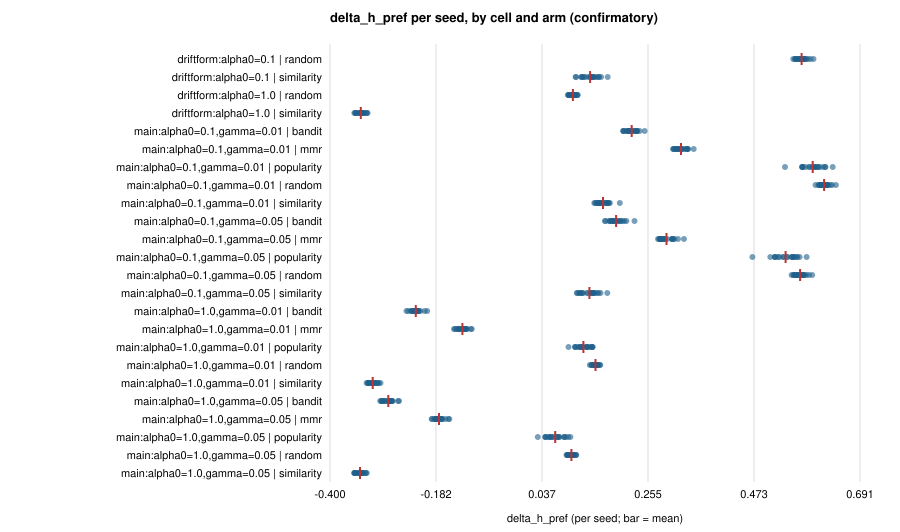
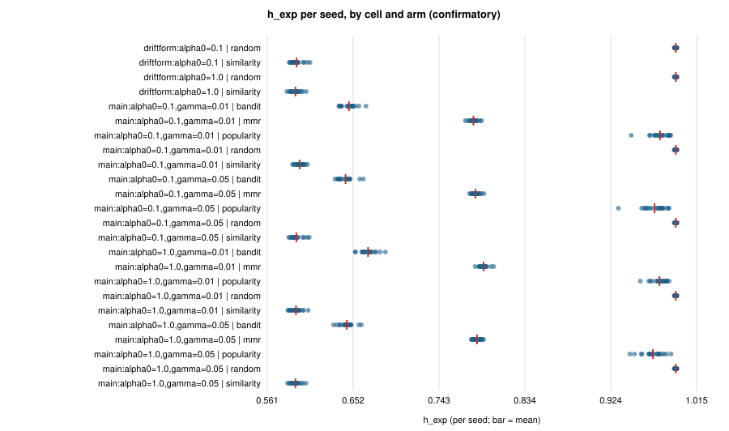

<!-- SPDX-License-Identifier: LicenseRef-PULSE-NC-Research-1.0 -->
# EXP-002 report: ranking objective and simulated preference reinforcement under drifting preferences

**Label: CONFIRMATORY. Status: complete (480 of 480 planned runs, 0 failed, 0 excluded). Verdict under the frozen rule: H1 supported. Drift-form sensitivity rule: not met (reinforcement not reported as dependent on the drift form), with a construct limitation found after the results.**

## 1. Identification

| Item | Value |
| --- | --- |
| Experiment | EXP-002, protocol v1.0 (frozen 2026-11-24, owner-approved, D-012) |
| Report date | 2026-11-25 (M3). Written after the run from the committed results, tables and figures only (owner decision D-015) |
| Authorship | Mohamed Bechir Kefi (no affiliation; owner decision C3). An AI system acted as research and development assistant; it is not an author. |
| Protocol SHA-256 | `e1f4d229803ee9684a12cb2c22ad5b217d8075d0f852ffc33f87604cb1b12b56` (main protocol `87fbfae1016c543f9736828d8e17d7015d42b894e62886eb798f38e3d8fcb12c`) |
| Config | `experiments/EXP-002.json`, file SHA-256 `d8311e7a67936b6019041c6ccf0eb593791431082c76b5957b10ac81ac2c71a2`, canonical SHA-256 `2c3b1816328f95d487bd83c1002a6db3970881a0eed91a2677569c3f2cfeed59` |
| Code revision | `f1838f3e8451c8c4275579a5736fe488354a8f3a` (clean tree for every run) |
| Machine-readable outputs | `results/raw/EXP-002/`, log `results/raw/logs/EXP-002.log`; in this folder `verdict.json`, `metrics.csv`, `summary.csv`, `contrasts.csv`, `run_manifest.json`, `runs.csv`, `config.json`, `tables.md`, `figures/` |

## 2. Executive summary

- **Question.** When simulated preferences drift toward liked topics, does the ranking objective change how much each user's preference distribution concentrates over T steps, relative to random ranking?
- **Method.** 5 rankers x drift rate gamma {0.01, 0.05} x alpha_0 {1.0, 0.1} x 20 paired seeds (400 runs). The drift-form check adds 80 runs: an additive-then-clip drift rule at gamma 0.05 for the similarity and random arms, at both alpha_0 levels. eta = 0.1, tau = 0.1, c = 0.066421.
- **Outcome.**
  - In the primary cell (gamma 0.05, alpha_0 1.0), similarity changed normalised preference entropy by -0.4350 relative to random (95% t-interval [-0.4387, -0.4313], 20 seeds).
  - Under random ranking, preference entropy rose (+0.0971). Under similarity it fell (-0.3379).
  - H1 was supported in all four cells. The drift-form check gave nearly identical contrasts.
- **Principal caveat.** Reinforcement is built into the drift assumption. The experiment measures how rankers interact with that assumption, not whether people drift. The drift-form check turned out to be weak (section 9).

## 3. Rationale and literature

- **Prior work.** Kalimeris et al. (KDD 2021, doi:10.1145/3447548.3467298) model users drifting toward recommended content and study conditions for preference amplification. Jiang et al. (2019, arXiv:1902.10730) formalise the degeneracy of user interest under feedback loops.
- **Gap addressed.** This experiment compares five concrete rankers under one explicit drift rule with matched pools. It is a simulation of the stated assumption only.

## 4. Hypotheses and operational definitions

- **Primary metric of this experiment.** Delta H_pref(u) = (H(p_u(T)) - H(p_u(0))) / ln K, with H(p) = -sum_z p_z ln p_z and the convention 0 ln 0 = 0.
  - Run value: mean over users.
  - Range [-1, 1]. Negative means concentration of preferences.
- **Drift rule.** After each like of an item with primary topic z, p_u <- normalise((1 - gamma) p_u + gamma onehot(z)). Dislikes leave p_u unchanged.
- **Contrast.** D = Delta H_pref(similarity) - Delta H_pref(random), paired by seed, in the primary cell (gamma 0.05, alpha_0 1.0).
- **Hypotheses.** H0: E[D] = 0. H1: E[D] < 0.
- **Contradiction (frozen).** The 95% t upper bound is >= 0, or the point estimate is above -0.05.
- **Secondary.**
  - Other cells; other arms against random; MMR against similarity.
  - H_exp and all secondary metrics. Relevance and miscalibration are evaluated against the current p_u(t).
  - Holm adjustment within each cell and metric family.
- **Drift-form rule (frozen, section 14).** Under the additive-then-clip rule p_u <- normalise(clip(p_u + gamma onehot(z), 0, 1)), reinforcement is reported as dependent on the drift form if the sign of D changes or |D| falls below 0.05. The D-013 reading compares the point estimates per alpha_0 at gamma 0.05.

## 5. Methodology

- **Model.** As EXP-001 (section 5 of its report), with drifting preferences and eta = 0.1 fixed.
- **Bandit.** The bandit arm uses alpha_ucb = 1.0.
- **Calibration.** c = 0.06642147188540548 (tau 0.1), fitted at alpha_0 1.0 without drift and used in every cell, including the drift-form check.
- **Seeds.** 102001 to 102020.
- **Runs.**
  - Block `main`: 5 x 2 x 2 x 20 = 400.
  - Block `driftform`: 2 arms x 2 alpha_0 x 20 = 80.
  - Total: 480.
- **Statistics.** As EXP-001: paired t-interval, percentile bootstrap (10,000 resamples, seed 20261124), d_z, Holm, with seeds as units.
- **Software and hardware.**
  - Python 3.12.1 and numpy 2.3.5 on an Apple M1 Pro.
  - One process under `nice -n 10`, in parallel with EXP-001.
- **Budget.** At most 1.5 hours allowed; 828.2 s used.

## 6. Implementation verification

- **Before the run.** Same checks as EXP-001: test suite 153 passed, smoke rerun identical (XPL-M3-SMOKE), metric validation (XPL-M3-METRICS), run guard accepted.
- **Drift tests.** Unit tests cover the drift rule, simplex preservation and the 0 ln 0 convention.
- **Faithfulness check.** In every cell the random arm's H_exp (0.9933) is close to the pool topic entropy (0.9980, Table E).

## 7. Execution record

- **Command.** `nice -n 10 env PYTHONPATH=src .venv/bin/python -m pulse.cli run --experiment EXP-002`.
- **Timing and resources.**
  - Start 2026-11-24T23:33:55Z, end 2026-11-24T23:47:44Z (UTC).
  - Wall clock 828.2 s.
  - Peak resident memory 140,099,584 bytes.
  - Exit status 0.
- **Runs.** 480 planned, 480 ok, 0 failed, 0 excluded, no retry.
- **Provenance.** Per-run records are in `run_manifest.json` and `runs.csv`.
- **Deviations from the frozen protocol: none.**
  - The decision rules were coded before the run (D-013).
  - The reproduction-command text in protocol section 15 is outdated (freeze record); see `reproduction.md`.
  - The report was written after the run, under owner decision D-015 (owner, 2026-11-25, "approve all recommendations, RIGGED A").

## 8. Results

Source: `tables.md` (Tables A to E) and `verdict.json`.

**Primary metric, all cells (Table C).**

| Cell | D = Delta H_pref(similarity) - Delta H_pref(random) | 95% t-interval | 95% bootstrap | d_z | Frozen rule |
| --- | --- | --- | --- | --- | --- |
| gamma 0.05, alpha_0 1.0 (primary) | -0.4350 | [-0.4387, -0.4313] | [-0.4383, -0.4316] | -54.84 | H1 supported |
| gamma 0.01, alpha_0 1.0 | -0.4583 | [-0.4612, -0.4554] | [-0.4608, -0.4556] | -74.69 | H1 supported |
| gamma 0.01, alpha_0 0.1 | -0.4550 | [-0.4576, -0.4524] | [-0.4574, -0.4526] | -81.92 | H1 supported |
| gamma 0.05, alpha_0 0.1 | -0.4336 | [-0.4387, -0.4285] | [-0.4382, -0.4289] | -39.78 | H1 supported |

**Absolute Delta H_pref per arm, primary cell (Table A, mean with SD over 20 seeds).**

| Arm | Delta H_pref |
| --- | --- |
| random | 0.0971 (0.0061) |
| popularity | 0.0636 (0.0178) |
| MMR | -0.1754 (0.0099) |
| bandit | -0.2796 (0.0108) |
| similarity | -0.3379 (0.0080) |

At alpha_0 0.1, preference entropy rose under every arm, because users start concentrated. The rise was large under random (0.5676 at gamma 0.05) and small under similarity (0.1340).

**Other arms, primary cell (Table B, Delta H_pref).** Every Holm-adjusted p < 0.0001.

| Contrast | Mean | 95% t-interval |
| --- | --- | --- |
| popularity - random | -0.0335 | [-0.0411, -0.0259] |
| bandit - random | -0.3767 | [-0.3817, -0.3717] |
| mmr - random | -0.2725 | [-0.2765, -0.2684] |
| mmr - similarity | 0.1626 | [0.1582, 0.1669] |

The popularity contrast was below the smallest effect of interest in all four cells (-0.0235 to -0.0335).

**Exposure and secondary metrics, primary cell (Table B).**
- H_exp: similarity minus random -0.4025 [-0.4046, -0.4005].
- Relevance, evaluated against the current p_u(t): similarity minus random +0.2075 [0.2059, 0.2090].
- Like rate: similarity minus random +0.2287 [0.2276, 0.2299].
- Gini: similarity minus random +0.1734 [0.1711, 0.1757].
- Miscalibration KL: similarity minus random -0.0080 [-0.0101, -0.0060]. Popularity minus random 0.0011 [-0.0011, 0.0032], p Holm 0.3111. MMR minus similarity 0.0022 [-0.0001, 0.0046], p Holm 0.1180.
- User control: similarity minus random +0.0083 [0.0080, 0.0087]; MMR minus random +0.0381 [0.0376, 0.0386].

**Drift-form check, gamma 0.05 (Table D).**

| alpha_0 | D multiplicative | D additive-then-clip | 95% t (additive-then-clip) | Sign change | abs(D) < 0.05 | Dependent on drift form |
| --- | --- | --- | --- | --- | --- | --- |
| 1.0 | -0.4350 | -0.4363 | [-0.4400, -0.4326] | no | no | no |
| 0.1 | -0.4336 | -0.4351 | [-0.4402, -0.4300] | no | no | no |

**Figures.**

## 9. Interpretation

- **Expected vs observed.**
  - Expected: similarity concentrates preferences more than random.
  - Observed: a contrast of about -0.43 to -0.46 in every cell, far beyond the smallest effect of interest.
  - Not anticipated in the protocol text: under random ranking, preferences did not concentrate on average. Delta H_pref was positive (+0.0971 at alpha_0 1.0). In this model the reinforcing loop appears only when exposure itself is concentrated.
- **Measured vs model-dependent.**
  - Measured: under the stated drift rule, the ranker strongly governs whether simulated preferences concentrate or spread.
  - Model-dependent: the drift rule itself encodes reinforcement. The experiment shows how rankers interact with it (limitations 4).
- **Ordering.** The ordering of arms matches their H_exp ordering: similarity, then bandit, then MMR, then popularity, then random. Diversity-aware re-ranking (MMR) recovered about 37% of the similarity contrast (MMR minus similarity +0.1626 against similarity minus random -0.4350). The M3 text said "roughly halved"; corrected in the M4 evidence audit (finding F-3).
- **Drift-form check (negative finding on the check itself).**
  - The frozen rule was not met: the additive-then-clip contrasts equal the multiplicative ones to within 0.0015.
  - After the results it was found that, for non-negative preferences, additive-then-clip followed by normalisation equals the multiplicative rule with rate gamma/(1 + gamma) (0.0476 instead of 0.05), unless the clip at 1 binds (limitations 12).
  - The check therefore tests little more than a small change of gamma. "Not dependent on drift form" has limited construct value. A genuinely different drift form would need a new experiment.
- **Literature.** The result is consistent with the amplification mechanism modelled by Kalimeris et al. 2021 and Jiang et al. 2019. It adds matched-ranker effect sizes under one rule.
- **Evidence.** The result supports H1 under the frozen rule.
- **M4 addendum (2026-11-25).** The M4 exploratory check found the static-preference exposure effect near zero at low like rates (`research/publication/interpretation_m4.md`). Whether the same holds under drift was not tested; this result is stated at the calibrated midpoint only (limitations 17).

## 10. Threats to validity

- **Internal.** As EXP-001. Common random numbers match catalogs, users and pools across arms within a seed.
- **Construct.**
  - Delta H_pref measures the concentration of a latent preference vector that is defined by the model.
  - The drift-form check is close to a reparametrisation (limitations 12).
  - Relevance and miscalibration refer to the current, drifted preferences.
- **Statistical.** Paired-difference SD 0.0079 in the primary cell (`contrasts.csv`). Large d_z values reflect small seed variation (limitations 14).
- **External.** Synthetic users only. No claim about real preference change, real platforms or addiction.
- **Calibration.** c was fitted without drift. Like rates under drift differ from the target, for example 0.5668 for random and 0.7955 for similarity in the primary cell (Table A).

## 11. Conclusion and next experiment

Under the stated drift rule, similarity ranking concentrated simulated preferences by 0.4350 normalised entropy units relative to random (95% t-interval [-0.4387, -0.4313]). H1 is supported under the frozen rule. The registered drift-form sensitivity check did not change the conclusion, but it is weak by construction.

A follow-up with a structurally different drift rule would need a new experiment id and would remain exploratory until frozen. Examples are drift toward exposed rather than liked topics, or bounded-confidence drift.

## 12. Reproduction appendix

See `reproduction.md`.

- **Raw results.** `results/raw/EXP-002/runs/*.json`, with checksums in `run_manifest.json`.
- **Data manifest.** SHA-256 `296b1edc9522d06275b20fc29fae08b0fc0405f880cf81fc9174ee26699a9fc0`. No real data file is read.
- **Dependencies.** `uv.lock`.
- **Figures.** Generated by `scripts/analyse_experiment.py`.
- **References.** In `research/paper/references.bib`: Kalimeris et al. 2021 (doi:10.1145/3447548.3467298), Jiang et al. 2019 (arXiv:1902.10730), Li et al. 2010, Carbonell and Goldstein 1998, Steck 2018.
