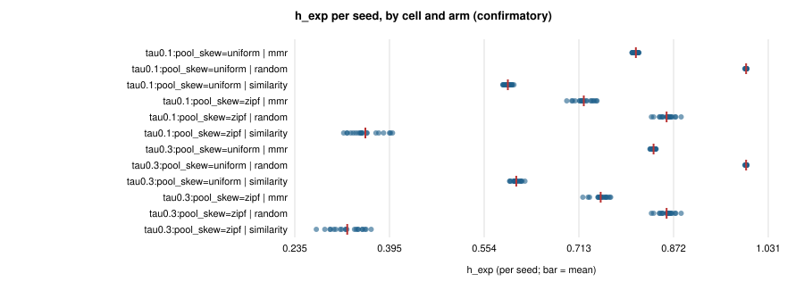

<!-- SPDX-License-Identifier: LicenseRef-PULSE-NC-Research-1.0 -->
# EXP-003 report: sensitivity of the primary contrast to candidate-pool skew and choice-model sharpness

**Label: CONFIRMATORY (sensitivity analysis registered in protocol section 10). Status: complete (240 of 240 planned runs, 0 failed, 0 excluded). Verdict: H1 supported in all four cells; neither invalidation criterion met; no sign reversal.**

## 1. Identification

| Item | Value |
| --- | --- |
| Experiment | EXP-003, protocol v1.0 (frozen 2026-11-24, owner-approved, D-012) |
| Report date | 2026-11-25 (M3). Written after the run from the committed results, tables and figures only (owner decision D-015) |
| Authorship | Mohamed Bechir Kefi, independent researcher (owner decision C3; author line confirmed by the owner on 2026-11-26). An AI system acted as research and development assistant; it is not an author. |
| Protocol SHA-256 | `07e68a736cfa05850970859b0ac14e5c8a19e4ce241fe48940dcc83be3b672eb` (main protocol `87fbfae1016c543f9736828d8e17d7015d42b894e62886eb798f38e3d8fcb12c`) |
| Config | `experiments/EXP-003.json`, file SHA-256 `418e85636e4120bcc2b74dab6a1385cf7421beeeb1874ccb39bcd96cc58d2081`, canonical SHA-256 `4aafb0446e763a37fe78cf83e00d94bdfc65fd5282579e82e5bd2cd1474b934f` |
| Code revision | `f1838f3e8451c8c4275579a5736fe488354a8f3a` (clean tree for every run) |
| Machine-readable outputs | `results/raw/EXP-003/`, log `results/raw/logs/EXP-003.log`; in this folder `verdict.json`, `metrics.csv`, `summary.csv`, `contrasts.csv`, `run_manifest.json`, `runs.csv`, `config.json`, `tables.md`, `figures/` |

## 2. Executive summary

- **Question.** Do the EXP-001 primary contrast (similarity minus random in H_exp) and the MMR recovery effect persist when the catalog's topic distribution is skewed (Zipf, s = 1) and when the like-probability curve is flatter (tau 0.3)?
- **Method.** 3 rankers (random, similarity, MMR) x pool skew {uniform, Zipf} x tau {0.1, 0.3} x 20 seeds = 240 runs.
  - Static preferences, eta 0.1, alpha_0 1.0.
  - Each tau has its own fitted midpoint: c(0.1) = 0.066421, c(0.3) = 0.005990.
- **Outcome.**
  - The contrast was strongly negative in every cell: -0.4001 (tau 0.1, uniform), -0.5060 (tau 0.1, Zipf; primary cell), -0.3861 (tau 0.3, uniform), -0.5365 (tau 0.3, Zipf).
  - Neither the skew nor the sharpness invalidation criterion was met.
  - The reduction was larger under the Zipf catalog. Interaction (Zipf minus uniform): -0.1059 at tau 0.1, -0.1503 at tau 0.3.
- **Principal caveat.** Before the freeze, an exploratory 2-seed sweep under the planning midpoint 0.5 showed the opposite sign in the Zipf cells (freeze record C4). The direction under skew therefore appears to depend on the choice-curve calibration (limitations 15).

## 3. Rationale and literature

Simulation conclusions depend on modelling assumptions. T-RECS (Lucherini et al. 2021, arXiv:2107.08959) and RecSim (Ie et al. 2019, arXiv:1909.04847) both present simulation as a set of configurable assumptions. That motivates testing the two assumptions most likely to drive the EXP-001 result: pool composition and choice sharpness.

## 4. Hypotheses and operational definitions

- **Contrast per cell.** Delta = H_exp(similarity) - H_exp(random), paired by seed. The metric is defined as in EXP-001.
- **Primary cell.** Block `tau0.1`, pool skew Zipf (protocol section 16).
- **Invalidation criteria (frozen, section 5 and protocol 15.9).**
  - Skew: if, in a Zipf cell, the 95% interval for Delta includes 0, lies entirely above 0, or the point estimate is above -0.05, the EXP-001 interpretation is restricted to balanced pools.
  - Sharpness: the same test applies in the tau 0.3 cells. If met, the effect is reported as dependent on choice sharpness.
- **Reading of the criteria.** D-013 fixed this reading before the run: both Zipf cells are evaluated for skew, and both tau 0.3 cells for sharpness.
- **Interaction.** Per tau block, (mean Delta under Zipf) minus (mean Delta under uniform), with a Welch t-interval (seeds as units, unpaired because the catalogs differ).
- **Secondary.** Delta_MMR = H_exp(MMR) - H_exp(similarity) per cell; Gini, relevance, miscalibration; Holm within each cell and metric family.
- **Sign-reversal rule (protocol 15.9).** Applies if a Zipf cell's interval lies entirely above 0.

## 5. Methodology

- **Model.** As EXP-001, with static preferences, eta 0.1 and alpha_0 1.0.
- **Zipf catalog.** Topic weights pi_z proportional to 1/z, z = 1..10.
- **Calibration.** tau 0.1 uses c = 0.06642147188540548. tau 0.3 uses c = 0.005990049685351551. Both were fitted before the freeze to L* = 0.577143 (protocol 15.5).
- **Seeds and runs.** Seeds 103001 to 103020; 240 runs.
- **Statistics.** Paired t-intervals and bootstrap within cells; Welch t-interval with fractional Welch-Satterthwaite degrees of freedom for the interaction.
- **Software and hardware.**
  - Python 3.12.1 and numpy 2.3.5 on an Apple M1 Pro.
  - One process under `nice -n 10`, in parallel with EXP-004.
- **Budget.** At most 1 hour allowed; 252.2 s used.

## 6. Implementation verification

- **Before the run.** As EXP-001: 153 tests passed, smoke rerun identical, metric validation, run guard accepted.
- **Welch interval.** Covered by a golden test and a fractional-df quantile test (`tests/test_analysis.py`).
- **Catalog check.** The diagnostics (Table E) show the intended catalogs: pool topic entropy 0.9983 under the uniform catalog and 0.8648 under Zipf. The random arm's H_exp follows the pool: 0.9936 under uniform, 0.8601 under Zipf.

## 7. Execution record

- **Command.** `nice -n 10 env PYTHONPATH=src .venv/bin/python -m pulse.cli run --experiment EXP-003`.
- **Timing and resources.**
  - Start 2026-11-24T23:49:14Z, end 2026-11-24T23:53:26Z (UTC).
  - Wall clock 252.2 s.
  - Peak resident memory 151,076,864 bytes.
  - Exit status 0.
- **Runs.** 240 planned, 240 ok, 0 failed, 0 excluded, no retry.
- **Deviations from the frozen protocol: none.**
  - Decision rules were coded before the run (D-013).
  - Outdated reproduction text in protocol section 15 (freeze record).
  - The report was written after the run under owner decision D-015 (owner, 2026-11-25, "approve all recommendations, RIGGED A").

## 8. Results

Source: `tables.md` (Tables A to E) and `verdict.json`.

**Primary contrast per cell (Table C).**

| Cell | Delta = H_exp(similarity) - H_exp(random) | 95% t-interval | 95% bootstrap | d_z | Frozen rule |
| --- | --- | --- | --- | --- | --- |
| tau 0.1, Zipf (primary) | -0.5060 | [-0.5169, -0.4951] | [-0.5155, -0.4958] | -21.73 | H1 supported |
| tau 0.1, uniform | -0.4001 | [-0.4028, -0.3975] | [-0.4025, -0.3977] | -71.34 | H1 supported |
| tau 0.3, uniform | -0.3861 | [-0.3893, -0.3830] | [-0.3889, -0.3832] | -57.40 | H1 supported |
| tau 0.3, Zipf | -0.5365 | [-0.5469, -0.5260] | [-0.5461, -0.5271] | -24.10 | H1 supported |

- Skew criterion met: no (tau 0.1), no (tau 0.3).
- Sharpness criterion met: no (uniform), no (Zipf).
- Sign-reversal rule 15.9: not triggered in either Zipf cell.

**Skew interaction (Table D, Welch).**

| Block | Delta(Zipf) - Delta(uniform) | 95% Welch interval | df |
| --- | --- | --- | --- |
| tau 0.1 | -0.1059 | [-0.1170, -0.0948] | 21.2 |
| tau 0.3 | -0.1503 | [-0.1611, -0.1396] | 22.4 |

**Absolute H_exp (Table A, mean with SD over 20 seeds).**

| Cell | random | similarity | MMR |
| --- | --- | --- | --- |
| tau 0.1, uniform | 0.9936 (0.0008) | 0.5934 (0.0056) | 0.8085 (0.0039) |
| tau 0.1, Zipf | 0.8601 (0.0123) | 0.3540 (0.0253) | 0.7209 (0.0141) |
| tau 0.3, uniform | 0.9936 (0.0008) | 0.6075 (0.0068) | 0.8381 (0.0030) |
| tau 0.3, Zipf | 0.8601 (0.0123) | 0.3236 (0.0258) | 0.7492 (0.0119) |

**MMR recovery (Table B, H_exp, MMR minus similarity).** Every Holm-adjusted p < 0.0001.

| Cell | Mean | 95% t-interval |
| --- | --- | --- |
| tau 0.1, uniform | 0.2150 | [0.2126, 0.2174] |
| tau 0.1, Zipf | 0.3669 | [0.3597, 0.3741] |
| tau 0.3, uniform | 0.2306 | [0.2274, 0.2338] |
| tau 0.3, Zipf | 0.4256 | [0.4151, 0.4362] |

**Secondary metrics (Table B, similarity minus random).**

| Cell | Gini | relevance | miscal. KL | like rate |
| --- | --- | --- | --- | --- |
| tau 0.1, uniform | 0.1488 | 0.0581 | 0.2196 | 0.0987 |
| tau 0.1, Zipf | 0.2434 | 0.0477 | 1.1293 | 0.0829 |
| tau 0.3, uniform | 0.1378 | 0.0329 | 0.5331 | 0.0208 |
| tau 0.3, Zipf | 0.2703 | 0.0250 | 1.4988 | 0.0157 |

- **Intervals.** The intervals are in Table B; all of these secondary contrasts exclude 0.
- **Null contrasts.** In the tau 0.3 Zipf cell, MMR did not differ from similarity in relevance (-0.0003, 95% t [-0.0015, 0.0008], p Holm 0.5590) or in like rate (-0.0002, [-0.0009, 0.0006], p Holm 0.6587).

**Figures.**

## 9. Interpretation

- **Expected vs observed.**
  - The protocol anticipated that skew might shrink the gap, because a skewed pool lowers the random arm's entropy.
  - Observed: the random arm's entropy did fall (0.8601), but the similarity arm fell further (0.3540 at tau 0.1). The gap therefore widened by 0.1059.
  - A flatter choice curve (tau 0.3) reduced the uniform-catalog gap only slightly (-0.3861 vs -0.4001) and widened the Zipf gap.
- **Robustness verdict.** The EXP-001 interpretation is not restricted to balanced pools, and it is not dependent on choice sharpness, within this design.
- **Disagreement with the pre-freeze exploratory sweep (reported with equal prominence).**
  - Under the planning midpoint 0.5 (like rate about 0.02, 2 seeds), the Zipf cells showed similarity above random (+0.102649 and +0.090614; freeze record C4).
  - Under the frozen calibration (like rate near 0.56 in the random arm, Table A), the sign is strongly negative.
  - The mechanism proposed before the freeze, a dislike-dominated profile pushed away from the abundant topic (D-008 P4), is consistent with this pattern. It remains untested.
  - The direction of the skew result appears to depend on how often simulated users like what they see (limitations 15). No confirmatory run varies the target like rate (limitations 16).
- **Trade-offs.**
  - Under skew, MMR recovered more of the loss (+0.3669 and +0.4256), at almost no cost in relevance or like rate.
  - Similarity's miscalibration rose sharply under skew (+1.1293 and +1.4988 nats).
- **Literature.** This is consistent with simulation work that treats conclusions as conditional on configurable assumptions (Lucherini et al. 2021; Ie et al. 2019).
- **Evidence.** The result supports H1 in every cell.
- **M4 addendum (2026-11-25, EXPLORATORY, does not change the verdict).** The M4 exploratory check XPL-M4-LIKERATE repeated the tau 0.1 block with the midpoint refitted for target true like rates from 0.02 to 0.85 (5 seeds, current code). Under the Zipf catalog the similarity-minus-random contrast was positive at like rates 0.02, 0.05 and 0.15 (+0.1045, +0.1026, +0.0724) and negative from 0.30 upward (-0.1258 to -0.7106); at the frozen calibration it was -0.5021, close to the confirmatory -0.5060. This reproduces the pre-freeze reversal with the current code. The frozen verdict ("not restricted to balanced pools") holds at the frozen calibration only; the direction under skew depends on the like rate (`research/publication/interpretation_m4.md`; limitations 15 and 17).

## 10. Threats to validity

- **Internal.** Arms are matched within a (tau, skew) cell. Skew levels use different catalogs, so the interaction is unpaired. Its Welch interval accounts for that.
- **Construct.** A single Zipf exponent (s = 1) and two tau levels. The midpoint is fitted per tau on the uniform catalog, so like rates differ slightly by cell (limitations 11).
- **Statistical.** Paired-difference SD 0.0233 in the primary cell (`contrasts.csv`), larger than in uniform cells but still small relative to the effect.
- **External.** Synthetic users only. EXP-004 provides a skewed real-data-derived catalog.
- **Calibration dependence.** See section 9 and limitations 15.

## 11. Conclusion and next experiment

Within this simulation, the similarity-minus-random reduction in exposure entropy persisted and grew under a Zipf-skewed catalog: -0.5060 (95% t [-0.5169, -0.4951]) in the primary cell. It also persisted under a flatter choice curve. No invalidation criterion was met.

A natural next experiment would cross the target like rate with pool skew, to test the calibration dependence suggested by the pre-freeze exploratory values. It would need a new experiment id and would remain exploratory until frozen.

## 12. Reproduction appendix

See `reproduction.md`.

- **Raw results.** `results/raw/EXP-003/runs/*.json`, with checksums in `run_manifest.json`.
- **Data manifest.** SHA-256 `296b1edc9522d06275b20fc29fae08b0fc0405f880cf81fc9174ee26699a9fc0`.
- **Calibration output.** `results/calibration/calibration.json`, SHA-256 `aaf806d4a4a27108edc5538f7efd04f57395f7621a251ea97801a07235d5dff5`.
- **References.** In `research/paper/references.bib`: Lucherini et al. 2021 (arXiv:2107.08959), Ie et al. 2019 (arXiv:1909.04847), Carbonell and Goldstein 1998, Steck 2018.
