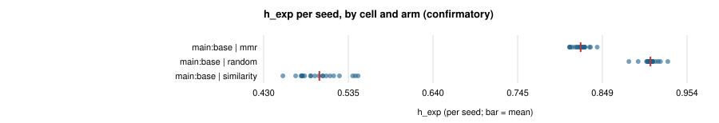

<!-- SPDX-License-Identifier: LicenseRef-PULSE-NC-Research-1.0 -->
# EXP-004 report: second test of the primary contrast on MovieLens-derived preferences and catalog

**Label: CONFIRMATORY (second test, protocol 15.6). Status: complete (60 of 60 planned runs, 0 failed, 0 excluded). Verdict under the frozen rule: H1 supported; contradiction rule not met; no sign reversal.**

## 1. Identification

| Item | Value |
| --- | --- |
| Experiment | EXP-004, protocol v1.0 (frozen 2026-11-24, owner-approved, D-012) |
| Report date | 2026-11-25 (M3). Written after the run from the committed results, tables and figures only (owner decision D-015) |
| Authorship | Mohamed Bechir Kefi (no affiliation; owner decision C3). An AI system acted as research and development assistant; it is not an author. |
| Protocol SHA-256 | `dc004421d10eb9ff3b9b6f31b826de6db7863198db5e6b3784726f605b3bcb13` (main protocol `87fbfae1016c543f9736828d8e17d7015d42b894e62886eb798f38e3d8fcb12c`) |
| Config | `experiments/EXP-004.json`, file SHA-256 `a3d1016854a67866ac1891b20769948cfe62a24e18a555c3186da94dba9719c2`, canonical SHA-256 `43afda057c89f26add143561edbc0b0033de19675b8b5ef1626103518cdba9b2` |
| Code revision | `f1838f3e8451c8c4275579a5736fe488354a8f3a` (clean tree for every run) |
| Data | MovieLens 1M zip SHA-256 `a6898adb50b9ca05aa231689da44c217cb524e7ebd39d264c56e2832f2c54e20`; held-out preference file `data/processed/ml1m_prefs_heldout.json` SHA-256 `75f9fb8ffa2a7e6eb14058b69d8d1722862591fd2447065de078415899f8c505` (git-ignored, never committed) |
| Machine-readable outputs | `results/raw/EXP-004/` (run-level aggregates only, no MovieLens row-level data), log `results/raw/logs/EXP-004.log`; in this folder `verdict.json`, `metrics.csv`, `summary.csv`, `contrasts.csv`, `run_manifest.json`, `runs.csv`, `config.json`, `tables.md`, `figures/` |

## 2. Executive summary

- **Question.** Does the EXP-001 primary contrast hold when users' initial preferences and the catalog's topic weights come from MovieLens 1M instead of the synthetic generators?
- **Method.** 3 rankers (random, similarity, MMR) x 20 seeds = 60 runs.
  - Each seed samples 200 users from the 3,020 held-out-half (even user id) preference vectors.
  - The catalog has 1,000 synthetic items whose primary topics follow pi_ML.
  - Static preferences, eta 0.0, tau 0.1, c_ML = 0.061067.
- **Outcome.** Similarity minus random in H_exp was -0.4095 (95% t-interval [-0.4210, -0.3980], 20 seeds). H1 is supported. MMR minus random was -0.0864.
- **Principal caveat.** The preference vectors are constructed from like counts (add-one smoothing, division by catalog share). The experiment tests the simulation on these inputs. It makes no claim about MovieLens users, who are not participants (limitations 9 and 10).

## 3. Rationale and literature

- **Why real inputs.** Simulation conclusions depend on the assumed preference distribution (Lucherini et al. 2021, arXiv:2107.08959; Ie et al. 2019, arXiv:1909.04847).
- **Why MovieLens.** MovieLens (Harper and Konstan 2015, doi:10.1145/2827872) is a standard public source of real user-item preferences.
- **Use here.** It serves only as input to the same simulation.
- **Licence and acknowledgement.** The GroupLens licence permits research use. This report acknowledges the dataset; no endorsement by the University of Minnesota or GroupLens is stated or implied, and the data is not redistributed.

## 4. Hypotheses and operational definitions

- **Contrast.** Delta = H_exp(similarity) - H_exp(random), paired by seed. H_exp is defined as in EXP-001.
- **Hypotheses.** H0: E[Delta] = 0. H1: E[Delta] < 0.
- **Contradiction rule (frozen).** The 95% t upper bound is >= 0, or the point estimate is above -0.05.
- **Sign reversal.** If the interval lies entirely above 0, the result is reported under protocol 15.9.
- **Secondary.** MMR minus random; MMR minus similarity; secondary metrics. User control is analysed as arm minus random only. Holm adjustment within each metric family.
- **Cross-experiment rule (15.6).** If EXP-001 supports H1 and EXP-004 meets its contradiction rule, the EXP-001 interpretation is restricted to the synthetic preference generator. EXP-004 is never pooled with EXP-001.

## 5. Methodology

- **Preference vectors (protocol 15.6).**
  - n_uz is the number of the user's ratings of 4 or more on included movies with primary topic z.
  - p_u is proportional to (n_uz + 1) / pi_ML,z, then normalised.
  - Topics are the 10 most frequent genres; the primary topic is the most specific top-10 genre.
- **Catalog.** pi_ML = 0.2536, 0.2027, 0.0463, 0.0755, 0.1155, 0.0741, 0.0368, 0.0697, 0.0684, 0.0575, for Drama, Comedy, Action, Thriller, Romance, Horror, Adventure, Sci-Fi, Children's and Crime (protocol 15.11).
- **Calibration.** c_ML = 0.06106666720006615, fitted on the calibration half (odd user ids) only (protocol 15.5, 15.11).
- **Seeds.** 104001 to 104020. The user sample is drawn per seed from the seed's "users" stream.
- **Data handling.**
  - The zip was re-verified by `scripts/download_movielens.py` without a new download.
  - The config pins the held-out file's SHA-256, and the simulator checks it before any step.
  - `users.dat` is never read.
- **Software and hardware.**
  - Python 3.12.1 and numpy 2.3.5 on an Apple M1 Pro.
  - One process under `nice -n 10`, in parallel with EXP-003.
- **Budget.** At most 15 minutes allowed; 72.4 s used.

## 6. Implementation verification

- **Before the run.** As EXP-001: 153 tests passed, smoke rerun identical, metric validation, run guard accepted.
- **Ingestion and preference file.** Tests cover ingestion, preference construction and the preference-file hash check (on a synthetic fixture).
- **Hash check.** The file's SHA-256 (75f9fb8f...) was checked at launch (log) and by the simulator.
- **Calibration check.** The random arm's like rate was 0.5761 (SD 0.0022, Table A), close to L* = 0.577143.
- **Catalog check.** The random arm's H_exp (0.9088) is close to the pool topic entropy (0.9139, Table E).

## 7. Execution record

- **Command.** `nice -n 10 env PYTHONPATH=src .venv/bin/python -m pulse.cli run --experiment EXP-004`.
- **Timing and resources.**
  - Start 2026-11-24T23:49:14Z, end 2026-11-24T23:50:26Z (UTC).
  - Wall clock 72.4 s.
  - Peak resident memory 151,748,608 bytes.
  - Exit status 0.
- **Runs.** 60 planned, 60 ok, 0 failed, 0 excluded, no retry.
- **Deviations from the frozen protocol: none.** The decision rules were coded before the run (D-013). The report was written after the run under owner decision D-015 (owner, 2026-11-25, "approve all recommendations, RIGGED A").

## 8. Results

Source: `tables.md` (Tables A, B, C, E) and `verdict.json`.

**Primary contrast (Table C).**

| Contrast | Mean | 95% t-interval | 95% bootstrap | d_z | Frozen rule |
| --- | --- | --- | --- | --- | --- |
| similarity - random (H_exp) | -0.4095 | [-0.4210, -0.3980] | [-0.4198, -0.3987] | -16.64 | H1 supported |

- Absolute H_exp (mean with SD over 20 seeds): random 0.9088 (0.0097), similarity 0.4993 (0.0257), MMR 0.8224 (0.0090).
- SD of paired differences: 0.0246 (`contrasts.csv`).
- Sign-reversal rule 15.9: not triggered.

**All contrasts (Table B; Holm within each metric family).** Holm-adjusted p < 0.0001 unless stated.

| Metric | similarity - random | mmr - random | mmr - similarity |
| --- | --- | --- | --- |
| H_exp | -0.4095 [-0.4210, -0.3980] | -0.0864 [-0.0911, -0.0817] | 0.3230 [0.3134, 0.3327] |
| Gini | 0.2175 [0.2080, 0.2270] | 0.2389 [0.2314, 0.2465] | 0.0214 [0.0121, 0.0307] (p Holm 0.0001) |
| relevance | 0.0395 [0.0380, 0.0410] | 0.0382 [0.0370, 0.0393] | -0.0013 [-0.0019, -0.0007] (p Holm 0.0002) |
| miscal. KL | 0.7431 [0.6951, 0.7910] | -0.2157 [-0.2338, -0.1976] | -0.9588 [-1.0002, -0.9174] |
| user control | 0.0196 [0.0183, 0.0209] | 0.0367 [0.0362, 0.0372] | not computed (15.7) |
| like rate | 0.0828 [0.0803, 0.0853] | 0.0812 [0.0791, 0.0833] | -0.0016 [-0.0029, -0.0003] (p Holm 0.0221) |

**Figures.**

## 9. Interpretation

- **Expected vs observed.**
  - Expected: the EXP-001 contrast might shrink, because the MovieLens-derived preferences are heterogeneous and the catalog is skewed.
  - Observed: -0.4095, close to EXP-001's -0.4000.
  - The contradiction rule is not met, so the EXP-001 interpretation is not restricted to the synthetic preference generator (cross-experiment rule 15.6).
- **Comparison with EXP-001 (descriptive, not pooled).**
  - Seed-to-seed variation is larger here: paired SD 0.0246 vs 0.0059, so d_z is smaller (-16.64 vs -67.47).
  - MMR's recovery is stronger here: MMR minus random -0.0864 vs -0.1853 in EXP-001.
  - With this catalog, MMR achieved almost the same relevance and like rate as similarity, while staying much closer to random in topic entropy.
- **Miscalibration.** Under similarity, miscalibration rose by 0.7431 nats. Under MMR it fell below random (-0.2157).
- **User control.** Both rankers were less responsive to dislikes than random, by this narrow metric (limitations 13).
- **Model-dependent inference.** The inputs are constructed (add-one smoothing, division by catalog share, one primary genre per movie), and the like target comes from selected exposure. The result concerns the simulation on these inputs, not MovieLens users.
- **Evidence.** The result supports H1 under the frozen rule.
- **M4 addendum (2026-11-25).** EXP-004 uses the same like-rate target as EXP-001 (c_ML fitted to L* = 0.577143). Its agreement with EXP-001 therefore shows that replacing the Dirichlet generator did not change the result at that calibration; it does not show robustness to the like rate, which the M4 exploratory check found to matter for synthetic users (`research/publication/interpretation_m4.md`; limitations 17). The MovieLens inputs were not included in that check.

## 10. Threats to validity

- **Internal.** Arms are matched within a seed: same user sample, catalog and pools.
- **Construct.** Constructed preference vectors (limitations 10); one primary topic per movie; synthetic item embeddings.
- **Selection.** MovieLens ratings reflect movies users chose to watch (limitations 9).
- **Statistical.** 20 seeds. The users of different seeds are drawn from the same 3,020 vectors, so seeds are not independent samples of new people. Inference is about the simulation, conditional on this population.
- **External.** One dataset and one genre-to-topic mapping. No claim about any real platform or person.

## 11. Conclusion and next experiment

With MovieLens-derived initial preferences and catalog topic weights, content-similarity ranking lowered exposure topic entropy by 0.4095 relative to random (95% t [-0.4210, -0.3980]). H1 is supported, and the EXP-001 interpretation is not restricted to the synthetic preference generator.

A follow-up could use a second dataset, or multi-genre item topics. It would need a new experiment id and would remain exploratory until frozen.

## 12. Reproduction appendix

See `reproduction.md`.

- **Real data.** The download and prepare scripts regenerate the git-ignored files, verified by SHA-256.
- **Raw results.** `results/raw/EXP-004/runs/*.json`, with checksums in `run_manifest.json`.
- **References.** In `research/paper/references.bib`: Harper and Konstan 2015 (doi:10.1145/2827872), Lucherini et al. 2021, Ie et al. 2019, Carbonell and Goldstein 1998, Steck 2018.
