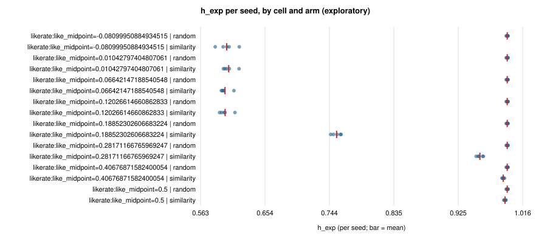

<!-- SPDX-License-Identifier: LicenseRef-PULSE-NC-Research-1.0 -->
# XPL-M4-LIKERATE-UNIFORM result set report (generated)

**EXPLORATORY. Not a finding. Protocol not frozen; these runs inform planning values only.**

Generated by `pulse.report` from 80 validated result files. Git revision at run time: 17c2e5f3cd1f905c7914f4bc4d5ed4c70811f4e3 (dirty: False). Experiment config hash: e10e8f06c5994110fd6ea420c7e9afad3bdf666ed6d19718dd23972ed3194a04.

## Execution

- Runs: 80; failed: 0.
- Wall clock for the set: 61.341 s.
- Runtime per run: mean 0.766 s, min 0.692 s, max 0.882 s.
- Platform: macOS-15.3.1-arm64-arm-64bit; CPU: Apple M1 Pro; Python 3.12.1; numpy 2.3.5.

## Per-arm summary (mean over seeds)

H_exp: final-window normalised exposure topic entropy; Gini: item exposure concentration; rel.: mean true utility of examined items; like: observed like rate; ctrl: user-control metric; dH_pref: normalised preference-entropy change (drifting model only).

| cell | arm | n | H_exp | H_exp SD | Gini | rel. | like | ctrl | dH_pref |
| --- | --- | --- | --- | --- | --- | --- | --- | --- | --- |
| likerate:like_midpoint=-0.08099950884934515 | random | 5 | 0.9939 | 0.0010 | 0.0559 | 0.0999 | 0.7801 | -0.0891 | NA |
| likerate:like_midpoint=-0.08099950884934515 | similarity | 5 | 0.6001 | 0.0123 | 0.2814 | 0.1158 | 0.7952 | -0.0722 | NA |
| likerate:like_midpoint=0.01042797404807061 | random | 5 | 0.9939 | 0.0010 | 0.0559 | 0.0999 | 0.6615 | -0.0890 | NA |
| likerate:like_midpoint=0.01042797404807061 | similarity | 5 | 0.6028 | 0.0087 | 0.2433 | 0.1394 | 0.7163 | -0.0752 | NA |
| likerate:like_midpoint=0.06642147188540548 | random | 5 | 0.9939 | 0.0010 | 0.0559 | 0.0999 | 0.5626 | -0.0891 | NA |
| likerate:like_midpoint=0.06642147188540548 | similarity | 5 | 0.5977 | 0.0072 | 0.2021 | 0.1589 | 0.6636 | -0.0784 | NA |
| likerate:like_midpoint=0.12026614660862833 | random | 5 | 0.9939 | 0.0010 | 0.0559 | 0.0999 | 0.4602 | -0.0891 | NA |
| likerate:like_midpoint=0.12026614660862833 | similarity | 5 | 0.5978 | 0.0083 | 0.1449 | 0.1708 | 0.5934 | -0.0826 | NA |
| likerate:like_midpoint=0.18852302606683224 | random | 5 | 0.9939 | 0.0010 | 0.0559 | 0.0999 | 0.3396 | -0.0892 | NA |
| likerate:like_midpoint=0.18852302606683224 | similarity | 5 | 0.7543 | 0.0063 | 0.2962 | 0.1598 | 0.4460 | -0.1134 | NA |
| likerate:like_midpoint=0.28171166765969247 | random | 5 | 0.9939 | 0.0010 | 0.0559 | 0.0999 | 0.2197 | -0.0891 | NA |
| likerate:like_midpoint=0.28171166765969247 | similarity | 5 | 0.9555 | 0.0043 | 0.4915 | 0.1199 | 0.2487 | -0.1664 | NA |
| likerate:like_midpoint=0.40676871582400054 | random | 5 | 0.9939 | 0.0010 | 0.0559 | 0.0999 | 0.1394 | -0.0890 | NA |
| likerate:like_midpoint=0.40676871582400054 | similarity | 5 | 0.9881 | 0.0013 | 0.5118 | 0.1047 | 0.1438 | -0.1866 | NA |
| likerate:like_midpoint=0.5 | random | 5 | 0.9939 | 0.0010 | 0.0559 | 0.0999 | 0.1159 | -0.0891 | NA |
| likerate:like_midpoint=0.5 | similarity | 5 | 0.9906 | 0.0012 | 0.5103 | 0.1017 | 0.1174 | -0.1907 | NA |

## Paired contrasts (treatment minus control, paired by seed)

95% t-interval and percentile bootstrap (10,000 resamples) over seeds; d_z = mean / SD of differences; Holm adjustment within each cell and metric family. All metrics are in contrasts.csv. With few seeds these intervals are wide and only indicate scale.

| cell | metric | contrast | n | mean | SD | 95% t CI | 95% boot CI | d_z | p Holm |
| --- | --- | --- | --- | --- | --- | --- | --- | --- | --- |
| likerate:like_midpoint=-0.08099950884934515 | h_exp | similarity - random | 5 | -0.3937 | 0.0114 | [-0.4080, -0.3795] | [-0.4021, -0.3841] | -34.3888 | 0.0000 |
| likerate:like_midpoint=0.01042797404807061 | h_exp | similarity - random | 5 | -0.3910 | 0.0080 | [-0.4009, -0.3811] | [-0.3959, -0.3838] | -49.1320 | 0.0000 |
| likerate:like_midpoint=0.06642147188540548 | h_exp | similarity - random | 5 | -0.3961 | 0.0068 | [-0.4046, -0.3877] | [-0.4002, -0.3902] | -58.4035 | 0.0000 |
| likerate:like_midpoint=0.12026614660862833 | h_exp | similarity - random | 5 | -0.3960 | 0.0078 | [-0.4058, -0.3863] | [-0.4011, -0.3891] | -50.4597 | 0.0000 |
| likerate:like_midpoint=0.18852302606683224 | h_exp | similarity - random | 5 | -0.2396 | 0.0062 | [-0.2473, -0.2318] | [-0.2445, -0.2347] | -38.4029 | 0.0000 |
| likerate:like_midpoint=0.28171166765969247 | h_exp | similarity - random | 5 | -0.0384 | 0.0038 | [-0.0432, -0.0336] | [-0.0414, -0.0354] | -10.0215 | 0.0000 |
| likerate:like_midpoint=0.40676871582400054 | h_exp | similarity - random | 5 | -0.0057 | 0.0016 | [-0.0077, -0.0038] | [-0.0071, -0.0049] | -3.6942 | 0.0012 |
| likerate:like_midpoint=0.5 | h_exp | similarity - random | 5 | -0.0032 | 0.0015 | [-0.0051, -0.0013] | [-0.0046, -0.0023] | -2.0875 | 0.0095 |

