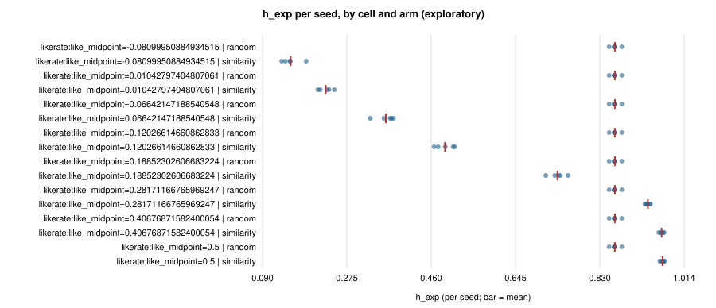

<!-- SPDX-License-Identifier: LicenseRef-PULSE-NC-Research-1.0 -->
# XPL-M4-LIKERATE-ZIPF result set report (generated)

**EXPLORATORY. Not a finding. Protocol not frozen; these runs inform planning values only.**

Generated by `pulse.report` from 80 validated result files. Git revision at run time: 17c2e5f3cd1f905c7914f4bc4d5ed4c70811f4e3 (dirty: False). Experiment config hash: 0408cce6bff840bbe3c3df2a64db27ae949c4c85c26b0b88cb309a4d2d81c0ee.

## Execution

- Runs: 80; failed: 0.
- Wall clock for the set: 60.447 s.
- Runtime per run: mean 0.755 s, min 0.669 s, max 0.882 s.
- Platform: macOS-15.3.1-arm64-arm-64bit; CPU: Apple M1 Pro; Python 3.12.1; numpy 2.3.5.

## Per-arm summary (mean over seeds)

H_exp: final-window normalised exposure topic entropy; Gini: item exposure concentration; rel.: mean true utility of examined items; like: observed like rate; ctrl: user-control metric; dH_pref: normalised preference-entropy change (drifting model only).

| cell | arm | n | H_exp | H_exp SD | Gini | rel. | like | ctrl | dH_pref |
| --- | --- | --- | --- | --- | --- | --- | --- | --- | --- |
| likerate:like_midpoint=-0.08099950884934515 | random | 5 | 0.8625 | 0.0099 | 0.0559 | 0.1000 | 0.7808 | -0.0810 | NA |
| likerate:like_midpoint=-0.08099950884934515 | similarity | 5 | 0.1519 | 0.0205 | 0.5564 | 0.1092 | 0.7879 | -0.0245 | NA |
| likerate:like_midpoint=0.01042797404807061 | random | 5 | 0.8625 | 0.0099 | 0.0559 | 0.1000 | 0.6617 | -0.0811 | NA |
| likerate:like_midpoint=0.01042797404807061 | similarity | 5 | 0.2286 | 0.0146 | 0.4560 | 0.1253 | 0.6975 | -0.0356 | NA |
| likerate:like_midpoint=0.06642147188540548 | random | 5 | 0.8625 | 0.0099 | 0.0559 | 0.1000 | 0.5636 | -0.0811 | NA |
| likerate:like_midpoint=0.06642147188540548 | similarity | 5 | 0.3604 | 0.0206 | 0.2898 | 0.1494 | 0.6483 | -0.0544 | NA |
| likerate:like_midpoint=0.12026614660862833 | random | 5 | 0.8625 | 0.0099 | 0.0559 | 0.1000 | 0.4612 | -0.0814 | NA |
| likerate:like_midpoint=0.12026614660862833 | similarity | 5 | 0.4903 | 0.0198 | 0.1461 | 0.1653 | 0.5830 | -0.0739 | NA |
| likerate:like_midpoint=0.18852302606683224 | random | 5 | 0.8625 | 0.0099 | 0.0559 | 0.1000 | 0.3395 | -0.0812 | NA |
| likerate:like_midpoint=0.18852302606683224 | similarity | 5 | 0.7367 | 0.0178 | 0.3703 | 0.1537 | 0.4361 | -0.1109 | NA |
| likerate:like_midpoint=0.28171166765969247 | random | 5 | 0.8625 | 0.0099 | 0.0559 | 0.1000 | 0.2196 | -0.0813 | NA |
| likerate:like_midpoint=0.28171166765969247 | similarity | 5 | 0.9349 | 0.0051 | 0.5755 | 0.1175 | 0.2447 | -0.1551 | NA |
| likerate:like_midpoint=0.40676871582400054 | random | 5 | 0.8625 | 0.0099 | 0.0559 | 0.1000 | 0.1390 | -0.0812 | NA |
| likerate:like_midpoint=0.40676871582400054 | similarity | 5 | 0.9651 | 0.0046 | 0.5950 | 0.1042 | 0.1433 | -0.1746 | NA |
| likerate:like_midpoint=0.5 | random | 5 | 0.8625 | 0.0099 | 0.0559 | 0.1000 | 0.1159 | -0.0812 | NA |
| likerate:like_midpoint=0.5 | similarity | 5 | 0.9670 | 0.0046 | 0.5959 | 0.1016 | 0.1175 | -0.1786 | NA |

## Paired contrasts (treatment minus control, paired by seed)

95% t-interval and percentile bootstrap (10,000 resamples) over seeds; d_z = mean / SD of differences; Holm adjustment within each cell and metric family. All metrics are in contrasts.csv. With few seeds these intervals are wide and only indicate scale.

| cell | metric | contrast | n | mean | SD | 95% t CI | 95% boot CI | d_z | p Holm |
| --- | --- | --- | --- | --- | --- | --- | --- | --- | --- |
| likerate:like_midpoint=-0.08099950884934515 | h_exp | similarity - random | 5 | -0.7106 | 0.0113 | [-0.7247, -0.6965] | [-0.7181, -0.7011] | -62.7629 | 0.0000 |
| likerate:like_midpoint=0.01042797404807061 | h_exp | similarity - random | 5 | -0.6340 | 0.0100 | [-0.6464, -0.6215] | [-0.6427, -0.6278] | -63.4188 | 0.0000 |
| likerate:like_midpoint=0.06642147188540548 | h_exp | similarity - random | 5 | -0.5021 | 0.0140 | [-0.5195, -0.4847] | [-0.5137, -0.4921] | -35.9165 | 0.0000 |
| likerate:like_midpoint=0.12026614660862833 | h_exp | similarity - random | 5 | -0.3722 | 0.0219 | [-0.3994, -0.3450] | [-0.3890, -0.3556] | -16.9853 | 0.0000 |
| likerate:like_midpoint=0.18852302606683224 | h_exp | similarity - random | 5 | -0.1258 | 0.0178 | [-0.1479, -0.1038] | [-0.1399, -0.1125] | -7.0790 | 0.0001 |
| likerate:like_midpoint=0.28171166765969247 | h_exp | similarity - random | 5 | 0.0724 | 0.0122 | [0.0572, 0.0875] | [0.0625, 0.0811] | 5.9383 | 0.0002 |
| likerate:like_midpoint=0.40676871582400054 | h_exp | similarity - random | 5 | 0.1026 | 0.0103 | [0.0898, 0.1154] | [0.0944, 0.1101] | 9.9811 | 0.0000 |
| likerate:like_midpoint=0.5 | h_exp | similarity - random | 5 | 0.1045 | 0.0097 | [0.0925, 0.1165] | [0.0967, 0.1116] | 10.8265 | 0.0000 |

