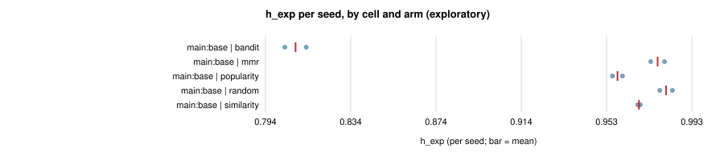

<!-- SPDX-License-Identifier: LicenseRef-PULSE-NC-Research-1.0 -->
# SMOKE result set report (generated)

**EXPLORATORY. Not a finding. Protocol not frozen; these runs inform planning values only.**

Generated by `pulse.report` from 10 validated result files. Git revision at run time: b9048556a635760ea092c3f15e034b0406195491 (dirty: False). Experiment config hash: 0dab3326ace2bc9f748d0ddc36b6adab8a86361622af39be91889cca86210a35.

## Execution

- Runs: 10; failed: 0.
- Wall clock for the set: 0.511 s.
- Runtime per run: mean 0.048 s, min 0.026 s, max 0.083 s.
- Platform: macOS-15.3.1-arm64-arm-64bit; CPU: Apple M1 Pro; Python 3.12.1; numpy 2.3.5.

## Per-arm summary (mean over seeds)

H_exp: final-window normalised exposure topic entropy; Gini: item exposure concentration; rel.: mean true utility of examined items; like: observed like rate; ctrl: user-control metric; dH_pref: normalised preference-entropy change (drifting model only).

| cell | arm | n | H_exp | H_exp SD | Gini | rel. | like | ctrl | dH_pref |
| --- | --- | --- | --- | --- | --- | --- | --- | --- | --- |
| main:base | bandit | 2 | 0.8080 | 0.0071 | 0.2000 | 0.1059 | 0.1163 | -0.0964 | NA |
| main:base | mmr | 2 | 0.9773 | 0.0046 | 0.5647 | 0.1012 | 0.1175 | -0.0729 | NA |
| main:base | popularity | 2 | 0.9586 | 0.0033 | 0.7876 | 0.1002 | 0.1138 | -0.0747 | NA |
| main:base | random | 2 | 0.9813 | 0.0042 | 0.0957 | 0.1004 | 0.1155 | -0.0869 | NA |
| main:base | similarity | 2 | 0.9686 | 0.0009 | 0.5514 | 0.1011 | 0.1166 | -0.1840 | NA |

## Paired contrasts (treatment minus control, paired by seed)

95% t-interval and percentile bootstrap (10,000 resamples) over seeds; d_z = mean / SD of differences; Holm adjustment within each cell and metric family. All metrics are in contrasts.csv. With few seeds these intervals are wide and only indicate scale.

| cell | metric | contrast | n | mean | SD | 95% t CI | 95% boot CI | d_z | p Holm |
| --- | --- | --- | --- | --- | --- | --- | --- | --- | --- |
| main:base | h_exp | bandit - random | 2 | -0.1733 | 0.0113 | [-0.2747, -0.0720] | [-0.1813, -0.1653] | -15.3628 | 0.1171 |
| main:base | h_exp | mmr - random | 2 | -0.0039 | 0.0004 | [-0.0071, -0.0008] | [-0.0042, -0.0037] | -11.1358 | 0.1211 |
| main:base | h_exp | popularity - random | 2 | -0.0227 | 0.0009 | [-0.0307, -0.0148] | [-0.0234, -0.0221] | -25.7436 | 0.0874 |
| main:base | h_exp | similarity - random | 2 | -0.0127 | 0.0034 | [-0.0428, 0.0174] | [-0.0150, -0.0103] | -3.7829 | 0.2353 |
| main:base | h_exp | mmr - similarity | 2 | 0.0087 | 0.0037 | [-0.0246, 0.0420] | [0.0061, 0.0114] | 2.3573 | 0.2353 |

