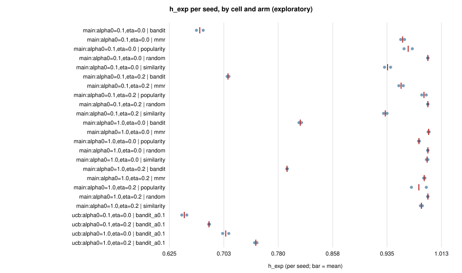

<!-- SPDX-License-Identifier: LicenseRef-PULSE-NC-Research-1.0 -->
# XPL-EXP-001-SWEEP result set report (generated)

**EXPLORATORY. Not a finding. Protocol not frozen; these runs inform planning values only.**

Generated by `pulse.report` from 48 validated result files. Git revision at run time: b9048556a635760ea092c3f15e034b0406195491 (dirty: False). Experiment config hash: e4562ae5f00357d05c8970e7c48594b9cb8ba84993ff1f7bf5f8ce96401c6283.

## Execution

- Runs: 48; failed: 0.
- Wall clock for the set: 57.344 s.
- Runtime per run: mean 1.192 s, min 0.713 s, max 2.811 s.
- Platform: macOS-15.3.1-arm64-arm-64bit; CPU: Apple M1 Pro; Python 3.12.1; numpy 2.3.5.

## Per-arm summary (mean over seeds)

H_exp: final-window normalised exposure topic entropy; Gini: item exposure concentration; rel.: mean true utility of examined items; like: observed like rate; ctrl: user-control metric; dH_pref: normalised preference-entropy change (drifting model only).

| cell | arm | n | H_exp | H_exp SD | Gini | rel. | like | ctrl | dH_pref |
| --- | --- | --- | --- | --- | --- | --- | --- | --- | --- |
| main:alpha0=0.1,eta=0.0 | bandit | 2 | 0.6683 | 0.0069 | 0.2727 | 0.2934 | 0.1889 | -0.0834 | NA |
| main:alpha0=0.1,eta=0.0 | mmr | 2 | 0.9574 | 0.0039 | 0.5229 | 0.1591 | 0.1028 | -0.0661 | NA |
| main:alpha0=0.1,eta=0.0 | popularity | 2 | 0.9653 | 0.0083 | 0.7831 | 0.1024 | 0.0547 | -0.0858 | NA |
| main:alpha0=0.1,eta=0.0 | random | 2 | 0.9934 | 0.0002 | 0.0564 | 0.0997 | 0.0403 | -0.0890 | NA |
| main:alpha0=0.1,eta=0.0 | similarity | 2 | 0.9360 | 0.0061 | 0.5165 | 0.1694 | 0.1125 | -0.1728 | NA |
| main:alpha0=0.1,eta=0.2 | bandit | 2 | 0.7086 | 0.0018 | 0.1137 | 0.2196 | 0.2824 | -0.0835 | NA |
| main:alpha0=0.1,eta=0.2 | mmr | 2 | 0.9552 | 0.0045 | 0.5220 | 0.1545 | 0.2585 | -0.0603 | NA |
| main:alpha0=0.1,eta=0.2 | popularity | 2 | 0.9878 | 0.0045 | 0.7865 | 0.1002 | 0.2251 | -0.0861 | NA |
| main:alpha0=0.1,eta=0.2 | random | 2 | 0.9934 | 0.0002 | 0.0564 | 0.0997 | 0.2244 | -0.0890 | NA |
| main:alpha0=0.1,eta=0.2 | similarity | 2 | 0.9327 | 0.0035 | 0.5160 | 0.1642 | 0.2647 | -0.1530 | NA |
| main:alpha0=1.0,eta=0.0 | bandit | 2 | 0.8115 | 0.0026 | 0.1451 | 0.1405 | 0.0323 | -0.0973 | NA |
| main:alpha0=1.0,eta=0.0 | mmr | 2 | 0.9944 | 0.0010 | 0.5499 | 0.1015 | 0.0222 | -0.0734 | NA |
| main:alpha0=1.0,eta=0.0 | popularity | 2 | 0.9807 | 0.0008 | 0.7770 | 0.1004 | 0.0205 | -0.0863 | NA |
| main:alpha0=1.0,eta=0.0 | random | 2 | 0.9934 | 0.0002 | 0.0564 | 0.1000 | 0.0200 | -0.0891 | NA |
| main:alpha0=1.0,eta=0.0 | similarity | 2 | 0.9924 | 0.0016 | 0.5403 | 0.1013 | 0.0214 | -0.1929 | NA |
| main:alpha0=1.0,eta=0.2 | bandit | 2 | 0.7927 | 0.0005 | 0.1739 | 0.1072 | 0.2131 | -0.0862 | NA |
| main:alpha0=1.0,eta=0.2 | mmr | 2 | 0.9883 | 0.0012 | 0.5507 | 0.1012 | 0.2124 | -0.0640 | NA |
| main:alpha0=1.0,eta=0.2 | popularity | 2 | 0.9806 | 0.0150 | 0.7862 | 0.1001 | 0.2121 | -0.0857 | NA |
| main:alpha0=1.0,eta=0.2 | random | 2 | 0.9934 | 0.0002 | 0.0564 | 0.1000 | 0.2120 | -0.0890 | NA |
| main:alpha0=1.0,eta=0.2 | similarity | 2 | 0.9842 | 0.0020 | 0.5425 | 0.1014 | 0.2130 | -0.1693 | NA |
| ucb:alpha0=0.1,eta=0.0 | bandit_a0.1 | 2 | 0.6462 | 0.0051 | 0.2674 | 0.2951 | 0.1898 | -0.0791 | NA |
| ucb:alpha0=0.1,eta=0.2 | bandit_a0.1 | 2 | 0.6815 | 0.0007 | 0.1080 | 0.2163 | 0.2810 | -0.0800 | NA |
| ucb:alpha0=1.0,eta=0.0 | bandit_a0.1 | 2 | 0.7053 | 0.0062 | 0.1131 | 0.1444 | 0.0337 | -0.0856 | NA |
| ucb:alpha0=1.0,eta=0.2 | bandit_a0.1 | 2 | 0.7482 | 0.0024 | 0.1520 | 0.1074 | 0.2133 | -0.0822 | NA |

## Paired contrasts (treatment minus control, paired by seed)

95% t-interval and percentile bootstrap (10,000 resamples) over seeds; d_z = mean / SD of differences; Holm adjustment within each cell and metric family. All metrics are in contrasts.csv. With few seeds these intervals are wide and only indicate scale.

| cell | metric | contrast | n | mean | SD | 95% t CI | 95% boot CI | d_z | p Holm |
| --- | --- | --- | --- | --- | --- | --- | --- | --- | --- |
| main:alpha0=0.1,eta=0.0 | h_exp | bandit - random | 2 | -0.3250 | 0.0070 | [-0.3881, -0.2619] | [-0.3300, -0.3201] | -46.2807 | 0.0486 |
| main:alpha0=0.1,eta=0.0 | h_exp | mmr - random | 2 | -0.0360 | 0.0040 | [-0.0722, 0.0002] | [-0.0388, -0.0331] | -8.9227 | 0.1869 |
| main:alpha0=0.1,eta=0.0 | h_exp | popularity - random | 2 | -0.0280 | 0.0082 | [-0.1013, 0.0452] | [-0.0338, -0.0223] | -3.4361 | 0.1869 |
| main:alpha0=0.1,eta=0.0 | h_exp | similarity - random | 2 | -0.0574 | 0.0063 | [-0.1136, -0.0012] | [-0.0618, -0.0530] | -9.1706 | 0.1869 |
| main:alpha0=0.1,eta=0.0 | h_exp | mmr - similarity | 2 | 0.0214 | 0.0022 | [0.0014, 0.0415] | [0.0199, 0.0230] | 9.6190 | 0.1869 |
| main:alpha0=0.1,eta=0.2 | h_exp | bandit - random | 2 | -0.2848 | 0.0020 | [-0.3029, -0.2666] | [-0.2862, -0.2833] | -141.0516 | 0.0160 |
| main:alpha0=0.1,eta=0.2 | h_exp | mmr - random | 2 | -0.0381 | 0.0047 | [-0.0800, 0.0037] | [-0.0414, -0.0348] | -8.1808 | 0.1098 |
| main:alpha0=0.1,eta=0.2 | h_exp | popularity - random | 2 | -0.0055 | 0.0044 | [-0.0448, 0.0337] | [-0.0086, -0.0024] | -1.2617 | 0.3252 |
| main:alpha0=0.1,eta=0.2 | h_exp | similarity - random | 2 | -0.0606 | 0.0037 | [-0.0939, -0.0274] | [-0.0633, -0.0580] | -16.3831 | 0.0824 |
| main:alpha0=0.1,eta=0.2 | h_exp | mmr - similarity | 2 | 0.0225 | 0.0010 | [0.0139, 0.0311] | [0.0219, 0.0232] | 23.5302 | 0.0765 |
| main:alpha0=1.0,eta=0.0 | h_exp | bandit - random | 2 | -0.1818 | 0.0024 | [-0.2034, -0.1603] | [-0.1835, -0.1801] | -75.8970 | 0.0297 |
| main:alpha0=1.0,eta=0.0 | h_exp | mmr - random | 2 | 0.0011 | 0.0012 | [-0.0093, 0.0115] | [0.0003, 0.0019] | 0.9344 | 0.8248 |
| main:alpha0=1.0,eta=0.0 | h_exp | popularity - random | 2 | -0.0126 | 0.0010 | [-0.0216, -0.0036] | [-0.0133, -0.0119] | -12.5408 | 0.1434 |
| main:alpha0=1.0,eta=0.0 | h_exp | similarity - random | 2 | -0.0010 | 0.0018 | [-0.0169, 0.0149] | [-0.0022, 0.0003] | -0.5561 | 0.8248 |
| main:alpha0=1.0,eta=0.0 | h_exp | mmr - similarity | 2 | 0.0021 | 0.0006 | [-0.0034, 0.0075] | [0.0016, 0.0025] | 3.4127 | 0.3902 |
| main:alpha0=1.0,eta=0.2 | h_exp | bandit - random | 2 | -0.2006 | 0.0003 | [-0.2034, -0.1979] | [-0.2009, -0.2004] | -660.3231 | 0.0034 |
| main:alpha0=1.0,eta=0.2 | h_exp | mmr - random | 2 | -0.0051 | 0.0014 | [-0.0173, 0.0072] | [-0.0061, -0.0041] | -3.7342 | 0.3324 |
| main:alpha0=1.0,eta=0.2 | h_exp | popularity - random | 2 | -0.0128 | 0.0148 | [-0.1459, 0.1204] | [-0.0232, -0.0023] | -0.8610 | 0.4377 |
| main:alpha0=1.0,eta=0.2 | h_exp | similarity - random | 2 | -0.0092 | 0.0021 | [-0.0282, 0.0099] | [-0.0107, -0.0077] | -4.3242 | 0.3324 |
| main:alpha0=1.0,eta=0.2 | h_exp | mmr - similarity | 2 | 0.0041 | 0.0008 | [-0.0027, 0.0109] | [0.0035, 0.0046] | 5.3866 | 0.3324 |

