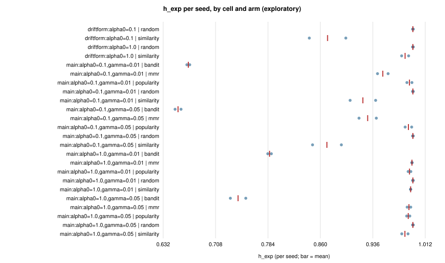
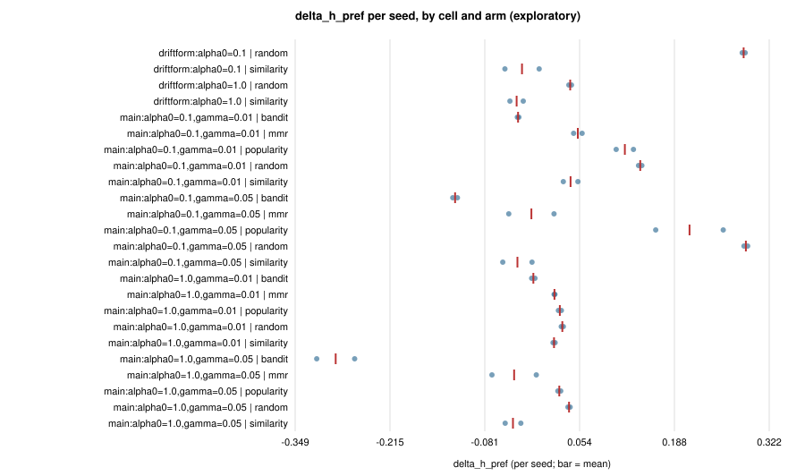

<!-- SPDX-License-Identifier: LicenseRef-PULSE-NC-Research-1.0 -->
# XPL-EXP-002-SWEEP result set report (generated)

**EXPLORATORY. Not a finding. Protocol not frozen; these runs inform planning values only.**

Generated by `pulse.report` from 48 validated result files. Git revision at run time: b9048556a635760ea092c3f15e034b0406195491 (dirty: False). Experiment config hash: a65b1f1337858058a10882487d2bbe87d0134391feebf309c03490777c8c3a45.

## Execution

- Runs: 48; failed: 0.
- Wall clock for the set: 61.432 s.
- Runtime per run: mean 1.277 s, min 0.715 s, max 2.747 s.
- Platform: macOS-15.3.1-arm64-arm-64bit; CPU: Apple M1 Pro; Python 3.12.1; numpy 2.3.5.

## Per-arm summary (mean over seeds)

H_exp: final-window normalised exposure topic entropy; Gini: item exposure concentration; rel.: mean true utility of examined items; like: observed like rate; ctrl: user-control metric; dH_pref: normalised preference-entropy change (drifting model only).

| cell | arm | n | H_exp | H_exp SD | Gini | rel. | like | ctrl | dH_pref |
| --- | --- | --- | --- | --- | --- | --- | --- | --- | --- |
| driftform:alpha0=0.1 | random | 2 | 0.9938 | 0.0008 | 0.0553 | 0.1003 | 0.1240 | -0.0894 | 0.2857 |
| driftform:alpha0=0.1 | similarity | 2 | 0.8702 | 0.0373 | 0.4801 | 0.2304 | 0.2470 | -0.1523 | -0.0279 |
| driftform:alpha0=1.0 | random | 2 | 0.9938 | 0.0008 | 0.0553 | 0.1003 | 0.1154 | -0.0893 | 0.0402 |
| driftform:alpha0=1.0 | similarity | 2 | 0.9825 | 0.0071 | 0.5396 | 0.1122 | 0.1276 | -0.1799 | -0.0355 |
| main:alpha0=0.1,gamma=0.01 | bandit | 2 | 0.6686 | 0.0029 | 0.1472 | 0.3050 | 0.2844 | -0.0833 | -0.0334 |
| main:alpha0=0.1,gamma=0.01 | mmr | 2 | 0.9502 | 0.0108 | 0.5192 | 0.1682 | 0.1917 | -0.0616 | 0.0511 |
| main:alpha0=0.1,gamma=0.01 | popularity | 2 | 0.9887 | 0.0051 | 0.7868 | 0.1016 | 0.1350 | -0.0860 | 0.1176 |
| main:alpha0=0.1,gamma=0.01 | random | 2 | 0.9938 | 0.0008 | 0.0553 | 0.1001 | 0.1289 | -0.0894 | 0.1394 |
| main:alpha0=0.1,gamma=0.01 | similarity | 2 | 0.9213 | 0.0261 | 0.5121 | 0.1834 | 0.2035 | -0.1603 | 0.0408 |
| main:alpha0=0.1,gamma=0.05 | bandit | 2 | 0.6537 | 0.0061 | 0.1629 | 0.3430 | 0.3238 | -0.0834 | -0.1226 |
| main:alpha0=0.1,gamma=0.05 | mmr | 2 | 0.9282 | 0.0177 | 0.4943 | 0.1964 | 0.2195 | -0.0608 | -0.0146 |
| main:alpha0=0.1,gamma=0.05 | popularity | 2 | 0.9872 | 0.0067 | 0.7867 | 0.1033 | 0.1323 | -0.0860 | 0.2091 |
| main:alpha0=0.1,gamma=0.05 | random | 2 | 0.9938 | 0.0008 | 0.0553 | 0.1003 | 0.1239 | -0.0894 | 0.2888 |
| main:alpha0=0.1,gamma=0.05 | similarity | 2 | 0.8693 | 0.0295 | 0.4774 | 0.2318 | 0.2486 | -0.1520 | -0.0344 |
| main:alpha0=1.0,gamma=0.01 | bandit | 2 | 0.7863 | 0.0036 | 0.1291 | 0.1362 | 0.1313 | -0.0875 | -0.0119 |
| main:alpha0=1.0,gamma=0.01 | mmr | 2 | 0.9924 | 0.0004 | 0.5554 | 0.1025 | 0.1175 | -0.0681 | 0.0181 |
| main:alpha0=1.0,gamma=0.01 | popularity | 2 | 0.9888 | 0.0028 | 0.7866 | 0.1001 | 0.1155 | -0.0858 | 0.0257 |
| main:alpha0=1.0,gamma=0.01 | random | 2 | 0.9938 | 0.0008 | 0.0553 | 0.1001 | 0.1150 | -0.0893 | 0.0291 |
| main:alpha0=1.0,gamma=0.01 | similarity | 2 | 0.9904 | 0.0000 | 0.5450 | 0.1023 | 0.1174 | -0.1813 | 0.0174 |
| main:alpha0=1.0,gamma=0.05 | bandit | 2 | 0.7406 | 0.0158 | 0.1157 | 0.2248 | 0.2041 | -0.0876 | -0.2915 |
| main:alpha0=1.0,gamma=0.05 | mmr | 2 | 0.9880 | 0.0036 | 0.5503 | 0.1097 | 0.1259 | -0.0675 | -0.0391 |
| main:alpha0=1.0,gamma=0.05 | popularity | 2 | 0.9870 | 0.0032 | 0.7867 | 0.1012 | 0.1162 | -0.0860 | 0.0248 |
| main:alpha0=1.0,gamma=0.05 | random | 2 | 0.9938 | 0.0008 | 0.0553 | 0.1003 | 0.1154 | -0.0893 | 0.0387 |
| main:alpha0=1.0,gamma=0.05 | similarity | 2 | 0.9821 | 0.0064 | 0.5386 | 0.1128 | 0.1280 | -0.1802 | -0.0407 |

## Paired contrasts (treatment minus control, paired by seed)

95% t-interval and percentile bootstrap (10,000 resamples) over seeds; d_z = mean / SD of differences; Holm adjustment within each cell and metric family. All metrics are in contrasts.csv. With few seeds these intervals are wide and only indicate scale.

| cell | metric | contrast | n | mean | SD | 95% t CI | 95% boot CI | d_z | p Holm |
| --- | --- | --- | --- | --- | --- | --- | --- | --- | --- |
| driftform:alpha0=0.1 | h_exp | similarity - random | 2 | -0.1236 | 0.0381 | [-0.4661, 0.2190] | [-0.1505, -0.0966] | -3.2413 | 0.1367 |
| driftform:alpha0=0.1 | delta_h_pref | similarity - random | 2 | -0.3136 | 0.0372 | [-0.6482, 0.0210] | [-0.3399, -0.2873] | -8.4200 | 0.0533 |
| driftform:alpha0=1.0 | h_exp | similarity - random | 2 | -0.0113 | 0.0079 | [-0.0825, 0.0599] | [-0.0169, -0.0057] | -1.4254 | 0.2932 |
| driftform:alpha0=1.0 | delta_h_pref | similarity - random | 2 | -0.0758 | 0.0159 | [-0.2184, 0.0668] | [-0.0870, -0.0646] | -4.7748 | 0.0936 |
| main:alpha0=0.1,gamma=0.01 | h_exp | bandit - random | 2 | -0.3251 | 0.0037 | [-0.3583, -0.2920] | [-0.3277, -0.3225] | -88.1563 | 0.0255 |
| main:alpha0=0.1,gamma=0.01 | h_exp | mmr - random | 2 | -0.0436 | 0.0116 | [-0.1477, 0.0605] | [-0.0518, -0.0354] | -3.7640 | 0.4729 |
| main:alpha0=0.1,gamma=0.01 | h_exp | popularity - random | 2 | -0.0051 | 0.0043 | [-0.0437, 0.0336] | [-0.0081, -0.0020] | -1.1777 | 0.4903 |
| main:alpha0=0.1,gamma=0.01 | h_exp | similarity - random | 2 | -0.0725 | 0.0269 | [-0.3142, 0.1693] | [-0.0915, -0.0535] | -2.6937 | 0.4903 |
| main:alpha0=0.1,gamma=0.01 | h_exp | mmr - similarity | 2 | 0.0289 | 0.0153 | [-0.1088, 0.1665] | [0.0180, 0.0397] | 1.8844 | 0.4903 |
| main:alpha0=0.1,gamma=0.01 | delta_h_pref | bandit - random | 2 | -0.1728 | 0.0018 | [-0.1889, -0.1567] | [-0.1741, -0.1715] | -96.2278 | 0.0234 |
| main:alpha0=0.1,gamma=0.01 | delta_h_pref | mmr - random | 2 | -0.0882 | 0.0118 | [-0.1945, 0.0180] | [-0.0966, -0.0799] | -7.4628 | 0.2406 |
| main:alpha0=0.1,gamma=0.01 | delta_h_pref | popularity - random | 2 | -0.0218 | 0.0140 | [-0.1476, 0.1041] | [-0.0317, -0.0119] | -1.5535 | 0.5037 |
| main:alpha0=0.1,gamma=0.01 | delta_h_pref | similarity - random | 2 | -0.0985 | 0.0179 | [-0.2594, 0.0623] | [-0.1112, -0.0859] | -5.5035 | 0.2440 |
| main:alpha0=0.1,gamma=0.01 | delta_h_pref | mmr - similarity | 2 | 0.0103 | 0.0061 | [-0.0443, 0.0649] | [0.0060, 0.0146] | 1.6931 | 0.5037 |
| main:alpha0=0.1,gamma=0.05 | h_exp | bandit - random | 2 | -0.3400 | 0.0069 | [-0.4016, -0.2784] | [-0.3449, -0.3352] | -49.5683 | 0.0454 |
| main:alpha0=0.1,gamma=0.05 | h_exp | mmr - random | 2 | -0.0655 | 0.0185 | [-0.2314, 0.1003] | [-0.0786, -0.0525] | -3.5490 | 0.3595 |
| main:alpha0=0.1,gamma=0.05 | h_exp | popularity - random | 2 | -0.0065 | 0.0059 | [-0.0597, 0.0467] | [-0.0107, -0.0023] | -1.1037 | 0.3627 |
| main:alpha0=0.1,gamma=0.05 | h_exp | similarity - random | 2 | -0.1245 | 0.0303 | [-0.3968, 0.1478] | [-0.1459, -0.1030] | -4.1067 | 0.3595 |
| main:alpha0=0.1,gamma=0.05 | h_exp | mmr - similarity | 2 | 0.0589 | 0.0118 | [-0.0475, 0.1654] | [0.0506, 0.0673] | 4.9758 | 0.3595 |
| main:alpha0=0.1,gamma=0.05 | delta_h_pref | bandit - random | 2 | -0.4114 | 0.0010 | [-0.4200, -0.4028] | [-0.4120, -0.4107] | -430.3858 | 0.0052 |
| main:alpha0=0.1,gamma=0.05 | delta_h_pref | mmr - random | 2 | -0.3034 | 0.0490 | [-0.7433, 0.1365] | [-0.3380, -0.2688] | -6.1972 | 0.2170 |
| main:alpha0=0.1,gamma=0.05 | delta_h_pref | popularity - random | 2 | -0.0797 | 0.0639 | [-0.6541, 0.4946] | [-0.1249, -0.0345] | -1.2473 | 0.6567 |
| main:alpha0=0.1,gamma=0.05 | delta_h_pref | similarity - random | 2 | -0.3232 | 0.0329 | [-0.6193, -0.0272] | [-0.3465, -0.2999] | -9.8111 | 0.1832 |
| main:alpha0=0.1,gamma=0.05 | delta_h_pref | mmr - similarity | 2 | 0.0198 | 0.0160 | [-0.1240, 0.1637] | [0.0085, 0.0312] | 1.2390 | 0.6567 |
| main:alpha0=1.0,gamma=0.01 | h_exp | bandit - random | 2 | -0.2075 | 0.0044 | [-0.2471, -0.1679] | [-0.2106, -0.2044] | -47.0976 | 0.0478 |
| main:alpha0=1.0,gamma=0.01 | h_exp | mmr - random | 2 | -0.0014 | 0.0012 | [-0.0119, 0.0091] | [-0.0022, -0.0005] | -1.1734 | 0.5959 |
| main:alpha0=1.0,gamma=0.01 | h_exp | popularity - random | 2 | -0.0050 | 0.0035 | [-0.0368, 0.0269] | [-0.0075, -0.0025] | -1.3989 | 0.5959 |
| main:alpha0=1.0,gamma=0.01 | h_exp | similarity - random | 2 | -0.0033 | 0.0008 | [-0.0105, 0.0039] | [-0.0039, -0.0027] | -4.1354 | 0.3382 |
| main:alpha0=1.0,gamma=0.01 | h_exp | mmr - similarity | 2 | 0.0019 | 0.0004 | [-0.0014, 0.0052] | [0.0017, 0.0022] | 5.2923 | 0.3382 |
| main:alpha0=1.0,gamma=0.01 | delta_h_pref | bandit - random | 2 | -0.0410 | 0.0053 | [-0.0889, 0.0069] | [-0.0448, -0.0372] | -7.6829 | 0.2921 |
| main:alpha0=1.0,gamma=0.01 | delta_h_pref | mmr - random | 2 | -0.0110 | 0.0029 | [-0.0374, 0.0154] | [-0.0131, -0.0089] | -3.7535 | 0.4742 |
| main:alpha0=1.0,gamma=0.01 | delta_h_pref | popularity - random | 2 | -0.0034 | 0.0009 | [-0.0119, 0.0051] | [-0.0041, -0.0028] | -3.6193 | 0.4742 |
| main:alpha0=1.0,gamma=0.01 | delta_h_pref | similarity - random | 2 | -0.0117 | 0.0042 | [-0.0493, 0.0260] | [-0.0146, -0.0087] | -2.7852 | 0.4742 |
| main:alpha0=1.0,gamma=0.01 | delta_h_pref | mmr - similarity | 2 | 0.0006 | 0.0013 | [-0.0106, 0.0119] | [-0.0002, 0.0015] | 0.5124 | 0.6008 |
| main:alpha0=1.0,gamma=0.05 | h_exp | bandit - random | 2 | -0.2531 | 0.0166 | [-0.4019, -0.1044] | [-0.2648, -0.2414] | -15.2875 | 0.1471 |
| main:alpha0=1.0,gamma=0.05 | h_exp | mmr - random | 2 | -0.0057 | 0.0044 | [-0.0453, 0.0338] | [-0.0089, -0.0026] | -1.3053 | 0.8212 |
| main:alpha0=1.0,gamma=0.05 | h_exp | popularity - random | 2 | -0.0068 | 0.0040 | [-0.0425, 0.0289] | [-0.0096, -0.0040] | -1.7041 | 0.8212 |
| main:alpha0=1.0,gamma=0.05 | h_exp | similarity - random | 2 | -0.0116 | 0.0072 | [-0.0762, 0.0529] | [-0.0167, -0.0066] | -1.6191 | 0.8212 |
| main:alpha0=1.0,gamma=0.05 | h_exp | mmr - similarity | 2 | 0.0059 | 0.0028 | [-0.0191, 0.0309] | [0.0039, 0.0079] | 2.1161 | 0.8212 |
| main:alpha0=1.0,gamma=0.05 | delta_h_pref | bandit - random | 2 | -0.3302 | 0.0401 | [-0.6903, 0.0299] | [-0.3585, -0.3019] | -8.2389 | 0.2180 |
| main:alpha0=1.0,gamma=0.05 | delta_h_pref | mmr - random | 2 | -0.0778 | 0.0465 | [-0.4952, 0.3397] | [-0.1106, -0.0449] | -1.6735 | 0.5090 |
| main:alpha0=1.0,gamma=0.05 | delta_h_pref | popularity - random | 2 | -0.0138 | 0.0008 | [-0.0206, -0.0070] | [-0.0144, -0.0133] | -18.3101 | 0.1229 |
| main:alpha0=1.0,gamma=0.05 | delta_h_pref | similarity - random | 2 | -0.0793 | 0.0178 | [-0.2388, 0.0802] | [-0.0919, -0.0668] | -4.4665 | 0.2999 |
| main:alpha0=1.0,gamma=0.05 | delta_h_pref | mmr - similarity | 2 | 0.0016 | 0.0287 | [-0.2564, 0.2595] | [-0.0187, 0.0219] | 0.0541 | 0.9514 |

