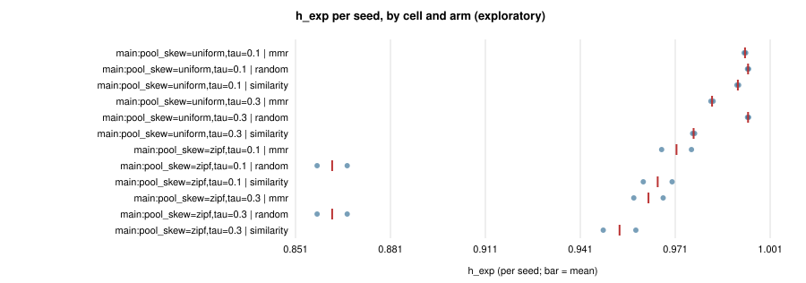

<!-- SPDX-License-Identifier: LicenseRef-PULSE-NC-Research-1.0 -->
# XPL-EXP-003-SWEEP result set report (generated)

**EXPLORATORY. Not a finding. Protocol not frozen; these runs inform planning values only.**

Generated by `pulse.report` from 24 validated result files. Git revision at run time: b9048556a635760ea092c3f15e034b0406195491 (dirty: False). Experiment config hash: 248893479d3a26ac4b2a0f381e0c6ea47e3f33b279c463abf6db5889ddfc7487.

## Execution

- Runs: 24; failed: 0.
- Wall clock for the set: 74.777 s.
- Runtime per run: mean 3.103 s, min 1.152 s, max 6.084 s.
- Platform: macOS-15.3.1-arm64-arm-64bit; CPU: Apple M1 Pro; Python 3.12.1; numpy 2.3.5.

## Per-arm summary (mean over seeds)

H_exp: final-window normalised exposure topic entropy; Gini: item exposure concentration; rel.: mean true utility of examined items; like: observed like rate; ctrl: user-control metric; dH_pref: normalised preference-entropy change (drifting model only).

| cell | arm | n | H_exp | H_exp SD | Gini | rel. | like | ctrl | dH_pref |
| --- | --- | --- | --- | --- | --- | --- | --- | --- | --- |
| main:pool_skew=uniform,tau=0.1 | mmr | 2 | 0.9929 | 0.0003 | 0.5222 | 0.1016 | 0.1169 | -0.0782 | NA |
| main:pool_skew=uniform,tau=0.1 | random | 2 | 0.9938 | 0.0003 | 0.0561 | 0.0999 | 0.1157 | -0.0892 | NA |
| main:pool_skew=uniform,tau=0.1 | similarity | 2 | 0.9906 | 0.0004 | 0.5125 | 0.1018 | 0.1176 | -0.1883 | NA |
| main:pool_skew=uniform,tau=0.3 | mmr | 2 | 0.9825 | 0.0005 | 0.5229 | 0.1053 | 0.2710 | -0.0665 | NA |
| main:pool_skew=uniform,tau=0.3 | random | 2 | 0.9938 | 0.0003 | 0.0561 | 0.0999 | 0.2674 | -0.0892 | NA |
| main:pool_skew=uniform,tau=0.3 | similarity | 2 | 0.9767 | 0.0004 | 0.5154 | 0.1058 | 0.2712 | -0.1602 | NA |
| main:pool_skew=zipf,tau=0.1 | mmr | 2 | 0.9713 | 0.0067 | 0.5937 | 0.1017 | 0.1170 | -0.0693 | NA |
| main:pool_skew=zipf,tau=0.1 | random | 2 | 0.8627 | 0.0067 | 0.0561 | 0.1013 | 0.1160 | -0.0817 | NA |
| main:pool_skew=zipf,tau=0.1 | similarity | 2 | 0.9653 | 0.0064 | 0.5774 | 0.1023 | 0.1175 | -0.1866 | NA |
| main:pool_skew=zipf,tau=0.3 | mmr | 2 | 0.9624 | 0.0065 | 0.5883 | 0.1061 | 0.2705 | -0.0628 | NA |
| main:pool_skew=zipf,tau=0.3 | random | 2 | 0.8627 | 0.0067 | 0.0561 | 0.1013 | 0.2676 | -0.0819 | NA |
| main:pool_skew=zipf,tau=0.3 | similarity | 2 | 0.9533 | 0.0073 | 0.5774 | 0.1061 | 0.2702 | -0.1572 | NA |

## Paired contrasts (treatment minus control, paired by seed)

95% t-interval and percentile bootstrap (10,000 resamples) over seeds; d_z = mean / SD of differences; Holm adjustment within each cell and metric family. All metrics are in contrasts.csv. With few seeds these intervals are wide and only indicate scale.

| cell | metric | contrast | n | mean | SD | 95% t CI | 95% boot CI | d_z | p Holm |
| --- | --- | --- | --- | --- | --- | --- | --- | --- | --- |
| main:pool_skew=uniform,tau=0.1 | h_exp | mmr - random | 2 | -0.0010 | 0.0001 | [-0.0017, -0.0002] | [-0.0010, -0.0009] | -11.3874 | 0.0395 |
| main:pool_skew=uniform,tau=0.1 | h_exp | similarity - random | 2 | -0.0032 | 0.0001 | [-0.0045, -0.0020] | [-0.0033, -0.0031] | -22.9025 | 0.0393 |
| main:pool_skew=uniform,tau=0.1 | h_exp | mmr - similarity | 2 | 0.0023 | 0.0001 | [0.0018, 0.0028] | [0.0022, 0.0023] | 40.4945 | 0.0333 |
| main:pool_skew=uniform,tau=0.3 | h_exp | mmr - random | 2 | -0.0114 | 0.0008 | [-0.0181, -0.0046] | [-0.0119, -0.0108] | -15.1003 | 0.0359 |
| main:pool_skew=uniform,tau=0.3 | h_exp | similarity - random | 2 | -0.0172 | 0.0007 | [-0.0233, -0.0110] | [-0.0176, -0.0167] | -25.0432 | 0.0359 |
| main:pool_skew=uniform,tau=0.3 | h_exp | mmr - similarity | 2 | 0.0058 | 0.0001 | [0.0052, 0.0064] | [0.0058, 0.0058] | 86.4698 | 0.0156 |
| main:pool_skew=zipf,tau=0.1 | h_exp | mmr - random | 2 | 0.1086 | 0.0001 | [0.1080, 0.1092] | [0.1085, 0.1086] | 1702.8668 | 0.0008 |
| main:pool_skew=zipf,tau=0.1 | h_exp | similarity - random | 2 | 0.1026 | 0.0003 | [0.1001, 0.1052] | [0.1024, 0.1029] | 359.4015 | 0.0025 |
| main:pool_skew=zipf,tau=0.1 | h_exp | mmr - similarity | 2 | 0.0059 | 0.0002 | [0.0039, 0.0079] | [0.0058, 0.0061] | 26.7699 | 0.0168 |
| main:pool_skew=zipf,tau=0.3 | h_exp | mmr - random | 2 | 0.0997 | 0.0002 | [0.0982, 0.1013] | [0.0996, 0.0999] | 570.4964 | 0.0024 |
| main:pool_skew=zipf,tau=0.3 | h_exp | similarity - random | 2 | 0.0906 | 0.0005 | [0.0857, 0.0955] | [0.0902, 0.0910] | 167.1794 | 0.0054 |
| main:pool_skew=zipf,tau=0.3 | h_exp | mmr - similarity | 2 | 0.0091 | 0.0007 | [0.0027, 0.0156] | [0.0086, 0.0096] | 12.7276 | 0.0353 |

