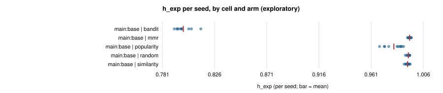

<!-- SPDX-License-Identifier: LicenseRef-PULSE-NC-Research-1.0 -->
# XPL-VAR result set report (generated)

**EXPLORATORY. Not a finding. Protocol not frozen; these runs inform planning values only.**

Generated by `pulse.report` from 50 validated result files. Git revision at run time: b9048556a635760ea092c3f15e034b0406195491 (dirty: False). Experiment config hash: 86124cdec2a740a13b4bc9d4f8ef41d52ee2fbf61c00ffdf401caa98225add78.

## Execution

- Runs: 50; failed: 0.
- Wall clock for the set: 56.301 s.
- Runtime per run: mean 1.125 s, min 0.693 s, max 3.200 s.
- Platform: macOS-15.3.1-arm64-arm-64bit; CPU: Apple M1 Pro; Python 3.12.1; numpy 2.3.5.

## Per-arm summary (mean over seeds)

H_exp: final-window normalised exposure topic entropy; Gini: item exposure concentration; rel.: mean true utility of examined items; like: observed like rate; ctrl: user-control metric; dH_pref: normalised preference-entropy change (drifting model only).

| cell | arm | n | H_exp | H_exp SD | Gini | rel. | like | ctrl | dH_pref |
| --- | --- | --- | --- | --- | --- | --- | --- | --- | --- |
| main:base | bandit | 10 | 0.7994 | 0.0070 | 0.1561 | 0.1460 | 0.0360 | -0.0956 | NA |
| main:base | mmr | 10 | 0.9942 | 0.0011 | 0.5298 | 0.1018 | 0.0227 | -0.0780 | NA |
| main:base | popularity | 10 | 0.9806 | 0.0075 | 0.7778 | 0.1006 | 0.0211 | -0.0859 | NA |
| main:base | random | 10 | 0.9932 | 0.0012 | 0.0561 | 0.1000 | 0.0206 | -0.0892 | NA |
| main:base | similarity | 10 | 0.9925 | 0.0016 | 0.5186 | 0.1018 | 0.0227 | -0.1985 | NA |

## Paired contrasts (treatment minus control, paired by seed)

95% t-interval and percentile bootstrap (10,000 resamples) over seeds; d_z = mean / SD of differences; Holm adjustment within each cell and metric family. All metrics are in contrasts.csv. With few seeds these intervals are wide and only indicate scale.

| cell | metric | contrast | n | mean | SD | 95% t CI | 95% boot CI | d_z | p Holm |
| --- | --- | --- | --- | --- | --- | --- | --- | --- | --- |
| main:base | h_exp | bandit - random | 10 | -0.1938 | 0.0070 | [-0.1988, -0.1887] | [-0.1975, -0.1895] | -27.4926 | 0.0000 |
| main:base | h_exp | mmr - random | 10 | 0.0010 | 0.0018 | [-0.0003, 0.0022] | [0.0001, 0.0022] | 0.5632 | 0.2173 |
| main:base | h_exp | popularity - random | 10 | -0.0125 | 0.0075 | [-0.0179, -0.0072] | [-0.0171, -0.0083] | -1.6775 | 0.0015 |
| main:base | h_exp | similarity - random | 10 | -0.0007 | 0.0022 | [-0.0022, 0.0009] | [-0.0018, 0.0007] | -0.3200 | 0.3381 |
| main:base | h_exp | mmr - similarity | 10 | 0.0017 | 0.0006 | [0.0013, 0.0021] | [0.0014, 0.0020] | 2.8718 | 0.0000 |

