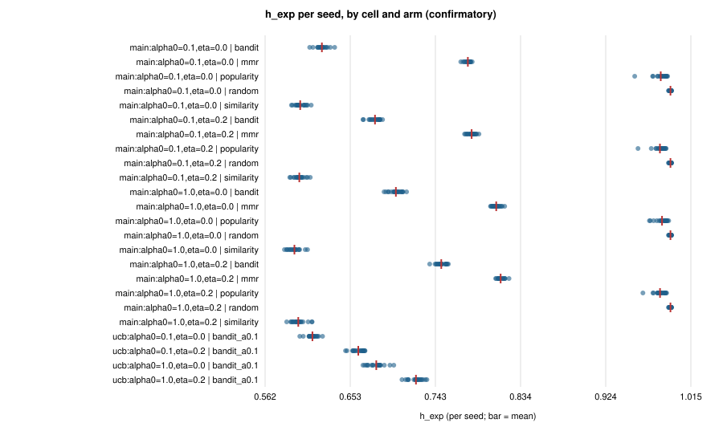

<!-- SPDX-License-Identifier: LicenseRef-PULSE-NC-Research-1.0 -->
# EXP-001 result set report (generated)

Label: ['confirmatory']

Generated by `pulse.report` from 480 validated result files. Git revision at run time: f1838f3e8451c8c4275579a5736fe488354a8f3a (dirty: False). Experiment config hash: e51281119eed3c3bcd8ce8042cadc37b104c9b670d4992574e1d2b1095b7afcc.

## Execution

- Runs: 480; failed: 0.
- Wall clock for the set: 904.635 s.
- Runtime per run: mean 1.883 s, min 0.757 s, max 5.552 s.
- Platform: macOS-15.3.1-arm64-arm-64bit; CPU: Apple M1 Pro; Python 3.12.1; numpy 2.3.5.

## Per-arm summary (mean over seeds)

H_exp: final-window normalised exposure topic entropy; Gini: item exposure concentration; rel.: mean true utility of examined items; like: observed like rate; ctrl: user-control metric; dH_pref: normalised preference-entropy change (drifting model only).

| cell | arm | n | H_exp | H_exp SD | Gini | rel. | like | ctrl | dH_pref |
| --- | --- | --- | --- | --- | --- | --- | --- | --- | --- |
| main:alpha0=0.1,eta=0.0 | bandit | 20 | 0.6224 | 0.0059 | 0.1990 | 0.2844 | 0.8378 | -0.0890 | NA |
| main:alpha0=0.1,eta=0.0 | mmr | 20 | 0.7778 | 0.0031 | 0.1268 | 0.2510 | 0.7839 | -0.0557 | NA |
| main:alpha0=0.1,eta=0.0 | popularity | 20 | 0.9829 | 0.0079 | 0.7868 | 0.1009 | 0.5522 | -0.0860 | NA |
| main:alpha0=0.1,eta=0.0 | random | 20 | 0.9932 | 0.0009 | 0.0559 | 0.1001 | 0.5482 | -0.0893 | NA |
| main:alpha0=0.1,eta=0.0 | similarity | 20 | 0.5994 | 0.0055 | 0.2220 | 0.2927 | 0.8478 | -0.0854 | NA |
| main:alpha0=0.1,eta=0.2 | bandit | 20 | 0.6789 | 0.0059 | 0.2277 | 0.2519 | 0.6748 | -0.0837 | NA |
| main:alpha0=0.1,eta=0.2 | mmr | 20 | 0.7818 | 0.0041 | 0.1187 | 0.2458 | 0.6650 | -0.0521 | NA |
| main:alpha0=0.1,eta=0.2 | popularity | 20 | 0.9820 | 0.0068 | 0.7868 | 0.1005 | 0.5306 | -0.0859 | NA |
| main:alpha0=0.1,eta=0.2 | random | 20 | 0.9932 | 0.0009 | 0.0559 | 0.1001 | 0.5288 | -0.0893 | NA |
| main:alpha0=0.1,eta=0.2 | similarity | 20 | 0.5984 | 0.0056 | 0.2107 | 0.2892 | 0.7054 | -0.0798 | NA |
| main:alpha0=1.0,eta=0.0 | bandit | 20 | 0.7012 | 0.0065 | 0.2286 | 0.1535 | 0.6921 | -0.0838 | NA |
| main:alpha0=1.0,eta=0.0 | mmr | 20 | 0.8079 | 0.0042 | 0.1474 | 0.1502 | 0.6847 | -0.0493 | NA |
| main:alpha0=1.0,eta=0.0 | popularity | 20 | 0.9843 | 0.0060 | 0.7867 | 0.1002 | 0.5773 | -0.0859 | NA |
| main:alpha0=1.0,eta=0.0 | random | 20 | 0.9932 | 0.0009 | 0.0559 | 0.0999 | 0.5770 | -0.0892 | NA |
| main:alpha0=1.0,eta=0.0 | similarity | 20 | 0.5932 | 0.0062 | 0.2098 | 0.1602 | 0.7053 | -0.0772 | NA |
| main:alpha0=1.0,eta=0.2 | bandit | 20 | 0.7494 | 0.0051 | 0.2637 | 0.1374 | 0.5953 | -0.0842 | NA |
| main:alpha0=1.0,eta=0.2 | mmr | 20 | 0.8126 | 0.0035 | 0.1206 | 0.1447 | 0.6039 | -0.0483 | NA |
| main:alpha0=1.0,eta=0.2 | popularity | 20 | 0.9822 | 0.0060 | 0.7867 | 0.1001 | 0.5462 | -0.0859 | NA |
| main:alpha0=1.0,eta=0.2 | random | 20 | 0.9932 | 0.0009 | 0.0559 | 0.0999 | 0.5462 | -0.0892 | NA |
| main:alpha0=1.0,eta=0.2 | similarity | 20 | 0.5973 | 0.0071 | 0.1909 | 0.1558 | 0.6173 | -0.0786 | NA |
| ucb:alpha0=0.1,eta=0.0 | bandit_a0.1 | 20 | 0.6124 | 0.0054 | 0.1927 | 0.2848 | 0.8373 | -0.0867 | NA |
| ucb:alpha0=0.1,eta=0.2 | bandit_a0.1 | 20 | 0.6611 | 0.0063 | 0.2195 | 0.2534 | 0.6755 | -0.0810 | NA |
| ucb:alpha0=1.0,eta=0.0 | bandit_a0.1 | 20 | 0.6803 | 0.0086 | 0.2182 | 0.1537 | 0.6922 | -0.0807 | NA |
| ucb:alpha0=1.0,eta=0.2 | bandit_a0.1 | 20 | 0.7225 | 0.0071 | 0.2480 | 0.1376 | 0.5952 | -0.0814 | NA |

## Paired contrasts (treatment minus control, paired by seed)

95% t-interval and percentile bootstrap (10,000 resamples) over seeds; d_z = mean / SD of differences; Holm adjustment within each cell and metric family. All metrics are in contrasts.csv. With few seeds these intervals are wide and only indicate scale.

| cell | metric | contrast | n | mean | SD | 95% t CI | 95% boot CI | d_z | p Holm |
| --- | --- | --- | --- | --- | --- | --- | --- | --- | --- |
| main:alpha0=0.1,eta=0.0 | h_exp | bandit - random | 20 | -0.3708 | 0.0059 | [-0.3736, -0.3681] | [-0.3733, -0.3683] | -63.2398 | 0.0000 |
| main:alpha0=0.1,eta=0.0 | h_exp | mmr - random | 20 | -0.2155 | 0.0028 | [-0.2168, -0.2141] | [-0.2167, -0.2143] | -76.3155 | 0.0000 |
| main:alpha0=0.1,eta=0.0 | h_exp | popularity - random | 20 | -0.0103 | 0.0077 | [-0.0139, -0.0067] | [-0.0139, -0.0075] | -1.3358 | 0.0000 |
| main:alpha0=0.1,eta=0.0 | h_exp | similarity - random | 20 | -0.3938 | 0.0053 | [-0.3963, -0.3913] | [-0.3960, -0.3915] | -74.5380 | 0.0000 |
| main:alpha0=0.1,eta=0.0 | h_exp | mmr - similarity | 20 | 0.1784 | 0.0042 | [0.1764, 0.1803] | [0.1765, 0.1802] | 42.7432 | 0.0000 |
| main:alpha0=0.1,eta=0.2 | h_exp | bandit - random | 20 | -0.3143 | 0.0057 | [-0.3169, -0.3116] | [-0.3168, -0.3120] | -55.4366 | 0.0000 |
| main:alpha0=0.1,eta=0.2 | h_exp | mmr - random | 20 | -0.2115 | 0.0039 | [-0.2133, -0.2096] | [-0.2131, -0.2099] | -54.5276 | 0.0000 |
| main:alpha0=0.1,eta=0.2 | h_exp | popularity - random | 20 | -0.0112 | 0.0064 | [-0.0142, -0.0082] | [-0.0142, -0.0089] | -1.7378 | 0.0000 |
| main:alpha0=0.1,eta=0.2 | h_exp | similarity - random | 20 | -0.3948 | 0.0055 | [-0.3974, -0.3922] | [-0.3971, -0.3924] | -71.9595 | 0.0000 |
| main:alpha0=0.1,eta=0.2 | h_exp | mmr - similarity | 20 | 0.1833 | 0.0038 | [0.1816, 0.1851] | [0.1817, 0.1850] | 48.0483 | 0.0000 |
| main:alpha0=1.0,eta=0.0 | h_exp | bandit - random | 20 | -0.2920 | 0.0062 | [-0.2950, -0.2891] | [-0.2947, -0.2894] | -46.9087 | 0.0000 |
| main:alpha0=1.0,eta=0.0 | h_exp | mmr - random | 20 | -0.1853 | 0.0042 | [-0.1873, -0.1834] | [-0.1871, -0.1835] | -43.7572 | 0.0000 |
| main:alpha0=1.0,eta=0.0 | h_exp | popularity - random | 20 | -0.0089 | 0.0055 | [-0.0115, -0.0064] | [-0.0115, -0.0068] | -1.6374 | 0.0000 |
| main:alpha0=1.0,eta=0.0 | h_exp | similarity - random | 20 | -0.4000 | 0.0059 | [-0.4028, -0.3972] | [-0.4025, -0.3974] | -67.4725 | 0.0000 |
| main:alpha0=1.0,eta=0.0 | h_exp | mmr - similarity | 20 | 0.2147 | 0.0047 | [0.2125, 0.2169] | [0.2127, 0.2167] | 45.9054 | 0.0000 |
| main:alpha0=1.0,eta=0.2 | h_exp | bandit - random | 20 | -0.2438 | 0.0051 | [-0.2462, -0.2414] | [-0.2460, -0.2417] | -47.5308 | 0.0000 |
| main:alpha0=1.0,eta=0.2 | h_exp | mmr - random | 20 | -0.1806 | 0.0037 | [-0.1824, -0.1789] | [-0.1821, -0.1790] | -49.0051 | 0.0000 |
| main:alpha0=1.0,eta=0.2 | h_exp | popularity - random | 20 | -0.0111 | 0.0058 | [-0.0138, -0.0083] | [-0.0137, -0.0088] | -1.8899 | 0.0000 |
| main:alpha0=1.0,eta=0.2 | h_exp | similarity - random | 20 | -0.3959 | 0.0069 | [-0.3991, -0.3927] | [-0.3988, -0.3928] | -57.3039 | 0.0000 |
| main:alpha0=1.0,eta=0.2 | h_exp | mmr - similarity | 20 | 0.2153 | 0.0069 | [0.2121, 0.2185] | [0.2124, 0.2183] | 31.4256 | 0.0000 |

