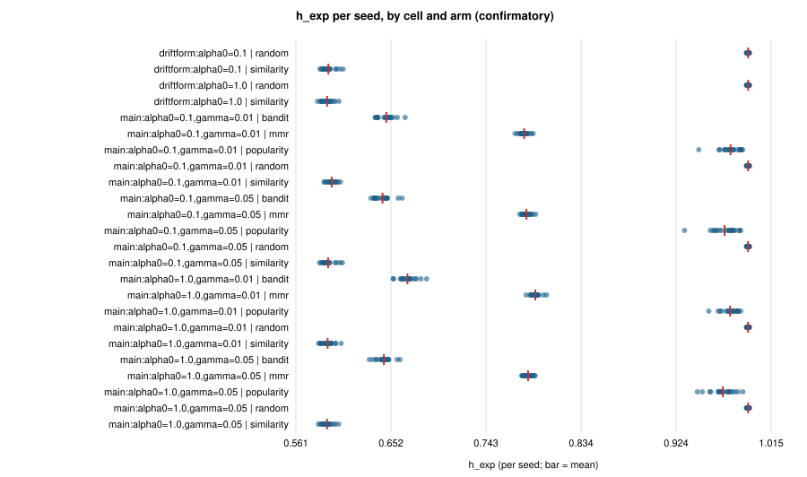
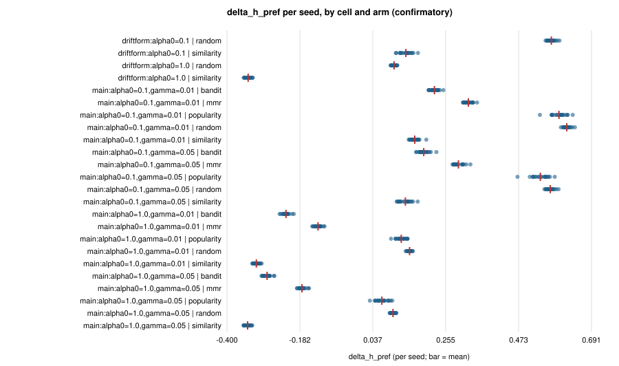

<!-- SPDX-License-Identifier: LicenseRef-PULSE-NC-Research-1.0 -->
# EXP-002 result set report (generated)

Label: ['confirmatory']

Generated by `pulse.report` from 480 validated result files. Git revision at run time: f1838f3e8451c8c4275579a5736fe488354a8f3a (dirty: False). Experiment config hash: 2c3b1816328f95d487bd83c1002a6db3970881a0eed91a2677569c3f2cfeed59.

## Execution

- Runs: 480; failed: 0.
- Wall clock for the set: 828.232 s.
- Runtime per run: mean 1.724 s, min 0.776 s, max 5.288 s.
- Platform: macOS-15.3.1-arm64-arm-64bit; CPU: Apple M1 Pro; Python 3.12.1; numpy 2.3.5.

## Per-arm summary (mean over seeds)

H_exp: final-window normalised exposure topic entropy; Gini: item exposure concentration; rel.: mean true utility of examined items; like: observed like rate; ctrl: user-control metric; dH_pref: normalised preference-entropy change (drifting model only).

| cell | arm | n | H_exp | H_exp SD | Gini | rel. | like | ctrl | dH_pref |
| --- | --- | --- | --- | --- | --- | --- | --- | --- | --- |
| driftform:alpha0=0.1 | random | 20 | 0.9933 | 0.0008 | 0.0560 | 0.1005 | 0.5669 | -0.0892 | 0.5706 |
| driftform:alpha0=0.1 | similarity | 20 | 0.5920 | 0.0060 | 0.2296 | 0.3073 | 0.7955 | -0.0805 | 0.1355 |
| driftform:alpha0=1.0 | random | 20 | 0.9933 | 0.0008 | 0.0560 | 0.1005 | 0.5669 | -0.0892 | 0.1001 |
| driftform:alpha0=1.0 | similarity | 20 | 0.5908 | 0.0052 | 0.2293 | 0.3083 | 0.7958 | -0.0808 | -0.3362 |
| main:alpha0=0.1,gamma=0.01 | bandit | 20 | 0.6474 | 0.0075 | 0.2001 | 0.2460 | 0.7507 | -0.0839 | 0.2212 |
| main:alpha0=0.1,gamma=0.01 | mmr | 20 | 0.7791 | 0.0042 | 0.1246 | 0.2137 | 0.7094 | -0.0522 | 0.3226 |
| main:alpha0=0.1,gamma=0.01 | popularity | 20 | 0.9766 | 0.0100 | 0.7868 | 0.1051 | 0.5759 | -0.0859 | 0.5935 |
| main:alpha0=0.1,gamma=0.01 | random | 20 | 0.9933 | 0.0008 | 0.0560 | 0.1005 | 0.5682 | -0.0892 | 0.6170 |
| main:alpha0=0.1,gamma=0.01 | similarity | 20 | 0.5951 | 0.0042 | 0.2245 | 0.3104 | 0.7981 | -0.0812 | 0.1620 |
| main:alpha0=0.1,gamma=0.05 | bandit | 20 | 0.6438 | 0.0077 | 0.1936 | 0.2426 | 0.7476 | -0.0828 | 0.1890 |
| main:alpha0=0.1,gamma=0.05 | mmr | 20 | 0.7813 | 0.0039 | 0.1330 | 0.2100 | 0.7050 | -0.0514 | 0.2927 |
| main:alpha0=0.1,gamma=0.05 | popularity | 20 | 0.9708 | 0.0127 | 0.7867 | 0.1071 | 0.5782 | -0.0861 | 0.5376 |
| main:alpha0=0.1,gamma=0.05 | random | 20 | 0.9933 | 0.0008 | 0.0560 | 0.1005 | 0.5668 | -0.0892 | 0.5676 |
| main:alpha0=0.1,gamma=0.05 | similarity | 20 | 0.5917 | 0.0058 | 0.2304 | 0.3071 | 0.7954 | -0.0805 | 0.1340 |
| main:alpha0=1.0,gamma=0.01 | bandit | 20 | 0.6676 | 0.0079 | 0.2026 | 0.2283 | 0.7375 | -0.0842 | -0.2230 |
| main:alpha0=1.0,gamma=0.01 | mmr | 20 | 0.7898 | 0.0044 | 0.1339 | 0.2014 | 0.6999 | -0.0504 | -0.1272 |
| main:alpha0=1.0,gamma=0.01 | popularity | 20 | 0.9760 | 0.0077 | 0.7867 | 0.1055 | 0.5768 | -0.0861 | 0.1217 |
| main:alpha0=1.0,gamma=0.01 | random | 20 | 0.9933 | 0.0008 | 0.0560 | 0.1005 | 0.5681 | -0.0892 | 0.1466 |
| main:alpha0=1.0,gamma=0.01 | similarity | 20 | 0.5913 | 0.0056 | 0.2281 | 0.3114 | 0.7983 | -0.0816 | -0.3117 |
| main:alpha0=1.0,gamma=0.05 | bandit | 20 | 0.6451 | 0.0070 | 0.1967 | 0.2415 | 0.7465 | -0.0831 | -0.2796 |
| main:alpha0=1.0,gamma=0.05 | mmr | 20 | 0.7829 | 0.0040 | 0.1343 | 0.2077 | 0.7028 | -0.0511 | -0.1754 |
| main:alpha0=1.0,gamma=0.05 | popularity | 20 | 0.9691 | 0.0110 | 0.7867 | 0.1080 | 0.5794 | -0.0859 | 0.0636 |
| main:alpha0=1.0,gamma=0.05 | random | 20 | 0.9933 | 0.0008 | 0.0560 | 0.1005 | 0.5668 | -0.0892 | 0.0971 |
| main:alpha0=1.0,gamma=0.05 | similarity | 20 | 0.5907 | 0.0049 | 0.2294 | 0.3079 | 0.7955 | -0.0808 | -0.3379 |

## Paired contrasts (treatment minus control, paired by seed)

95% t-interval and percentile bootstrap (10,000 resamples) over seeds; d_z = mean / SD of differences; Holm adjustment within each cell and metric family. All metrics are in contrasts.csv. With few seeds these intervals are wide and only indicate scale.

| cell | metric | contrast | n | mean | SD | 95% t CI | 95% boot CI | d_z | p Holm |
| --- | --- | --- | --- | --- | --- | --- | --- | --- | --- |
| driftform:alpha0=0.1 | h_exp | similarity - random | 20 | -0.4013 | 0.0055 | [-0.4038, -0.3987] | [-0.4034, -0.3987] | -72.5611 | 0.0000 |
| driftform:alpha0=0.1 | delta_h_pref | similarity - random | 20 | -0.4351 | 0.0110 | [-0.4402, -0.4300] | [-0.4398, -0.4305] | -39.6775 | 0.0000 |
| driftform:alpha0=1.0 | h_exp | similarity - random | 20 | -0.4025 | 0.0047 | [-0.4047, -0.4003] | [-0.4044, -0.4004] | -85.2332 | 0.0000 |
| driftform:alpha0=1.0 | delta_h_pref | similarity - random | 20 | -0.4363 | 0.0079 | [-0.4400, -0.4326] | [-0.4395, -0.4328] | -55.0158 | 0.0000 |
| main:alpha0=0.1,gamma=0.01 | h_exp | bandit - random | 20 | -0.3459 | 0.0074 | [-0.3494, -0.3424] | [-0.3490, -0.3428] | -46.4760 | 0.0000 |
| main:alpha0=0.1,gamma=0.01 | h_exp | mmr - random | 20 | -0.2142 | 0.0039 | [-0.2160, -0.2124] | [-0.2158, -0.2125] | -55.3480 | 0.0000 |
| main:alpha0=0.1,gamma=0.01 | h_exp | popularity - random | 20 | -0.0167 | 0.0101 | [-0.0214, -0.0120] | [-0.0214, -0.0127] | -1.6549 | 0.0000 |
| main:alpha0=0.1,gamma=0.01 | h_exp | similarity - random | 20 | -0.3981 | 0.0041 | [-0.4000, -0.3962] | [-0.3999, -0.3964] | -98.0004 | 0.0000 |
| main:alpha0=0.1,gamma=0.01 | h_exp | mmr - similarity | 20 | 0.1840 | 0.0034 | [0.1824, 0.1856] | [0.1825, 0.1855] | 53.6381 | 0.0000 |
| main:alpha0=0.1,gamma=0.01 | delta_h_pref | bandit - random | 20 | -0.3958 | 0.0085 | [-0.3998, -0.3918] | [-0.3995, -0.3923] | -46.4461 | 0.0000 |
| main:alpha0=0.1,gamma=0.01 | delta_h_pref | mmr - random | 20 | -0.2944 | 0.0057 | [-0.2971, -0.2917] | [-0.2967, -0.2919] | -51.3240 | 0.0000 |
| main:alpha0=0.1,gamma=0.01 | delta_h_pref | popularity - random | 20 | -0.0235 | 0.0151 | [-0.0306, -0.0164] | [-0.0306, -0.0176] | -1.5524 | 0.0000 |
| main:alpha0=0.1,gamma=0.01 | delta_h_pref | similarity - random | 20 | -0.4550 | 0.0056 | [-0.4576, -0.4524] | [-0.4574, -0.4526] | -81.9200 | 0.0000 |
| main:alpha0=0.1,gamma=0.01 | delta_h_pref | mmr - similarity | 20 | 0.1606 | 0.0048 | [0.1584, 0.1629] | [0.1586, 0.1627] | 33.6927 | 0.0000 |
| main:alpha0=0.1,gamma=0.05 | h_exp | bandit - random | 20 | -0.3495 | 0.0076 | [-0.3530, -0.3459] | [-0.3525, -0.3462] | -46.1698 | 0.0000 |
| main:alpha0=0.1,gamma=0.05 | h_exp | mmr - random | 20 | -0.2120 | 0.0036 | [-0.2137, -0.2103] | [-0.2135, -0.2103] | -58.1541 | 0.0000 |
| main:alpha0=0.1,gamma=0.05 | h_exp | popularity - random | 20 | -0.0225 | 0.0127 | [-0.0284, -0.0165] | [-0.0284, -0.0173] | -1.7655 | 0.0000 |
| main:alpha0=0.1,gamma=0.05 | h_exp | similarity - random | 20 | -0.4015 | 0.0054 | [-0.4041, -0.3990] | [-0.4036, -0.3991] | -74.6094 | 0.0000 |
| main:alpha0=0.1,gamma=0.05 | h_exp | mmr - similarity | 20 | 0.1896 | 0.0041 | [0.1877, 0.1915] | [0.1878, 0.1913] | 45.9929 | 0.0000 |
| main:alpha0=0.1,gamma=0.05 | delta_h_pref | bandit - random | 20 | -0.3786 | 0.0095 | [-0.3830, -0.3742] | [-0.3826, -0.3746] | -39.9017 | 0.0000 |
| main:alpha0=0.1,gamma=0.05 | delta_h_pref | mmr - random | 20 | -0.2748 | 0.0074 | [-0.2783, -0.2714] | [-0.2779, -0.2716] | -37.1163 | 0.0000 |
| main:alpha0=0.1,gamma=0.05 | delta_h_pref | popularity - random | 20 | -0.0299 | 0.0184 | [-0.0385, -0.0213] | [-0.0385, -0.0227] | -1.6299 | 0.0000 |
| main:alpha0=0.1,gamma=0.05 | delta_h_pref | similarity - random | 20 | -0.4336 | 0.0109 | [-0.4387, -0.4285] | [-0.4382, -0.4289] | -39.7781 | 0.0000 |
| main:alpha0=0.1,gamma=0.05 | delta_h_pref | mmr - similarity | 20 | 0.1587 | 0.0112 | [0.1535, 0.1640] | [0.1539, 0.1635] | 14.1406 | 0.0000 |
| main:alpha0=1.0,gamma=0.01 | h_exp | bandit - random | 20 | -0.3256 | 0.0079 | [-0.3293, -0.3219] | [-0.3290, -0.3222] | -41.2229 | 0.0000 |
| main:alpha0=1.0,gamma=0.01 | h_exp | mmr - random | 20 | -0.2034 | 0.0042 | [-0.2054, -0.2015] | [-0.2052, -0.2016] | -48.2184 | 0.0000 |
| main:alpha0=1.0,gamma=0.01 | h_exp | popularity - random | 20 | -0.0172 | 0.0077 | [-0.0208, -0.0136] | [-0.0208, -0.0142] | -2.2384 | 0.0000 |
| main:alpha0=1.0,gamma=0.01 | h_exp | similarity - random | 20 | -0.4019 | 0.0051 | [-0.4043, -0.3995] | [-0.4040, -0.3997] | -78.6704 | 0.0000 |
| main:alpha0=1.0,gamma=0.01 | h_exp | mmr - similarity | 20 | 0.1985 | 0.0053 | [0.1960, 0.2010] | [0.1961, 0.2007] | 37.1186 | 0.0000 |
| main:alpha0=1.0,gamma=0.01 | delta_h_pref | bandit - random | 20 | -0.3696 | 0.0095 | [-0.3740, -0.3651] | [-0.3735, -0.3654] | -39.0731 | 0.0000 |
| main:alpha0=1.0,gamma=0.01 | delta_h_pref | mmr - random | 20 | -0.2738 | 0.0074 | [-0.2772, -0.2703] | [-0.2768, -0.2704] | -36.8443 | 0.0000 |
| main:alpha0=1.0,gamma=0.01 | delta_h_pref | popularity - random | 20 | -0.0248 | 0.0112 | [-0.0301, -0.0196] | [-0.0301, -0.0204] | -2.2170 | 0.0000 |
| main:alpha0=1.0,gamma=0.01 | delta_h_pref | similarity - random | 20 | -0.4583 | 0.0061 | [-0.4612, -0.4554] | [-0.4608, -0.4556] | -74.6855 | 0.0000 |
| main:alpha0=1.0,gamma=0.01 | delta_h_pref | mmr - similarity | 20 | 0.1845 | 0.0081 | [0.1807, 0.1883] | [0.1810, 0.1880] | 22.8448 | 0.0000 |
| main:alpha0=1.0,gamma=0.05 | h_exp | bandit - random | 20 | -0.3482 | 0.0069 | [-0.3514, -0.3450] | [-0.3510, -0.3452] | -50.5007 | 0.0000 |
| main:alpha0=1.0,gamma=0.05 | h_exp | mmr - random | 20 | -0.2104 | 0.0038 | [-0.2122, -0.2086] | [-0.2120, -0.2088] | -55.8276 | 0.0000 |
| main:alpha0=1.0,gamma=0.05 | h_exp | popularity - random | 20 | -0.0242 | 0.0110 | [-0.0293, -0.0191] | [-0.0291, -0.0197] | -2.2067 | 0.0000 |
| main:alpha0=1.0,gamma=0.05 | h_exp | similarity - random | 20 | -0.4025 | 0.0044 | [-0.4046, -0.4005] | [-0.4043, -0.4006] | -92.2157 | 0.0000 |
| main:alpha0=1.0,gamma=0.05 | h_exp | mmr - similarity | 20 | 0.1921 | 0.0051 | [0.1898, 0.1945] | [0.1900, 0.1943] | 37.7635 | 0.0000 |
| main:alpha0=1.0,gamma=0.05 | delta_h_pref | bandit - random | 20 | -0.3767 | 0.0107 | [-0.3817, -0.3717] | [-0.3812, -0.3721] | -35.2387 | 0.0000 |
| main:alpha0=1.0,gamma=0.05 | delta_h_pref | mmr - random | 20 | -0.2725 | 0.0087 | [-0.2765, -0.2684] | [-0.2761, -0.2687] | -31.4280 | 0.0000 |
| main:alpha0=1.0,gamma=0.05 | delta_h_pref | popularity - random | 20 | -0.0335 | 0.0163 | [-0.0411, -0.0259] | [-0.0408, -0.0267] | -2.0594 | 0.0000 |
| main:alpha0=1.0,gamma=0.05 | delta_h_pref | similarity - random | 20 | -0.4350 | 0.0079 | [-0.4387, -0.4313] | [-0.4383, -0.4316] | -54.8382 | 0.0000 |
| main:alpha0=1.0,gamma=0.05 | delta_h_pref | mmr - similarity | 20 | 0.1626 | 0.0093 | [0.1582, 0.1669] | [0.1585, 0.1664] | 17.5649 | 0.0000 |

