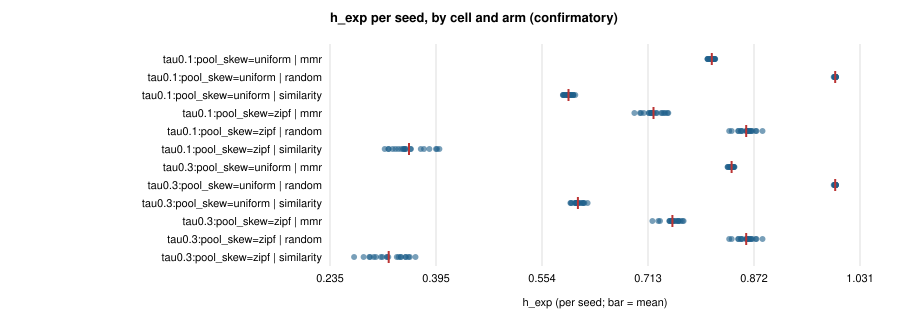

<!-- SPDX-License-Identifier: LicenseRef-PULSE-NC-Research-1.0 -->
# EXP-003 result set report (generated)

Label: ['confirmatory']

Generated by `pulse.report` from 240 validated result files. Git revision at run time: f1838f3e8451c8c4275579a5736fe488354a8f3a (dirty: False). Experiment config hash: 4aafb0446e763a37fe78cf83e00d94bdfc65fd5282579e82e5bd2cd1474b934f.

## Execution

- Runs: 240; failed: 0.
- Wall clock for the set: 252.186 s.
- Runtime per run: mean 1.048 s, min 0.711 s, max 1.881 s.
- Platform: macOS-15.3.1-arm64-arm-64bit; CPU: Apple M1 Pro; Python 3.12.1; numpy 2.3.5.

## Per-arm summary (mean over seeds)

H_exp: final-window normalised exposure topic entropy; Gini: item exposure concentration; rel.: mean true utility of examined items; like: observed like rate; ctrl: user-control metric; dH_pref: normalised preference-entropy change (drifting model only).

| cell | arm | n | H_exp | H_exp SD | Gini | rel. | like | ctrl | dH_pref |
| --- | --- | --- | --- | --- | --- | --- | --- | --- | --- |
| tau0.1:pool_skew=uniform | mmr | 20 | 0.8085 | 0.0039 | 0.1389 | 0.1477 | 0.6429 | -0.0487 | NA |
| tau0.1:pool_skew=uniform | random | 20 | 0.9936 | 0.0008 | 0.0556 | 0.1000 | 0.5616 | -0.0893 | NA |
| tau0.1:pool_skew=uniform | similarity | 20 | 0.5934 | 0.0056 | 0.2043 | 0.1581 | 0.6603 | -0.0777 | NA |
| tau0.1:pool_skew=zipf | mmr | 20 | 0.7209 | 0.0141 | 0.1497 | 0.1449 | 0.6394 | -0.0464 | NA |
| tau0.1:pool_skew=zipf | random | 20 | 0.8601 | 0.0123 | 0.0556 | 0.1000 | 0.5613 | -0.0815 | NA |
| tau0.1:pool_skew=zipf | similarity | 20 | 0.3540 | 0.0253 | 0.2989 | 0.1477 | 0.6441 | -0.0536 | NA |
| tau0.3:pool_skew=uniform | mmr | 20 | 0.8381 | 0.0030 | 0.1411 | 0.1256 | 0.5775 | -0.0465 | NA |
| tau0.3:pool_skew=uniform | random | 20 | 0.9936 | 0.0008 | 0.0556 | 0.1000 | 0.5613 | -0.0894 | NA |
| tau0.3:pool_skew=uniform | similarity | 20 | 0.6075 | 0.0068 | 0.1934 | 0.1329 | 0.5821 | -0.0785 | NA |
| tau0.3:pool_skew=zipf | mmr | 20 | 0.7492 | 0.0119 | 0.1599 | 0.1246 | 0.5770 | -0.0458 | NA |
| tau0.3:pool_skew=zipf | random | 20 | 0.8601 | 0.0123 | 0.0556 | 0.1000 | 0.5614 | -0.0815 | NA |
| tau0.3:pool_skew=zipf | similarity | 20 | 0.3236 | 0.0258 | 0.3259 | 0.1250 | 0.5771 | -0.0520 | NA |

## Paired contrasts (treatment minus control, paired by seed)

95% t-interval and percentile bootstrap (10,000 resamples) over seeds; d_z = mean / SD of differences; Holm adjustment within each cell and metric family. All metrics are in contrasts.csv. With few seeds these intervals are wide and only indicate scale.

| cell | metric | contrast | n | mean | SD | 95% t CI | 95% boot CI | d_z | p Holm |
| --- | --- | --- | --- | --- | --- | --- | --- | --- | --- |
| tau0.1:pool_skew=uniform | h_exp | mmr - random | 20 | -0.1851 | 0.0039 | [-0.1869, -0.1833] | [-0.1868, -0.1835] | -47.4827 | 0.0000 |
| tau0.1:pool_skew=uniform | h_exp | similarity - random | 20 | -0.4001 | 0.0056 | [-0.4028, -0.3975] | [-0.4025, -0.3977] | -71.3409 | 0.0000 |
| tau0.1:pool_skew=uniform | h_exp | mmr - similarity | 20 | 0.2150 | 0.0051 | [0.2126, 0.2174] | [0.2128, 0.2172] | 41.9655 | 0.0000 |
| tau0.1:pool_skew=zipf | h_exp | mmr - random | 20 | -0.1392 | 0.0118 | [-0.1447, -0.1336] | [-0.1442, -0.1342] | -11.7879 | 0.0000 |
| tau0.1:pool_skew=zipf | h_exp | similarity - random | 20 | -0.5060 | 0.0233 | [-0.5169, -0.4951] | [-0.5155, -0.4958] | -21.7253 | 0.0000 |
| tau0.1:pool_skew=zipf | h_exp | mmr - similarity | 20 | 0.3669 | 0.0154 | [0.3597, 0.3741] | [0.3600, 0.3733] | 23.8749 | 0.0000 |
| tau0.3:pool_skew=uniform | h_exp | mmr - random | 20 | -0.1555 | 0.0029 | [-0.1568, -0.1541] | [-0.1567, -0.1543] | -53.7091 | 0.0000 |
| tau0.3:pool_skew=uniform | h_exp | similarity - random | 20 | -0.3861 | 0.0067 | [-0.3893, -0.3830] | [-0.3889, -0.3832] | -57.3976 | 0.0000 |
| tau0.3:pool_skew=uniform | h_exp | mmr - similarity | 20 | 0.2306 | 0.0069 | [0.2274, 0.2338] | [0.2276, 0.2335] | 33.6248 | 0.0000 |
| tau0.3:pool_skew=zipf | h_exp | mmr - random | 20 | -0.1108 | 0.0105 | [-0.1157, -0.1059] | [-0.1151, -0.1063] | -10.5722 | 0.0000 |
| tau0.3:pool_skew=zipf | h_exp | similarity - random | 20 | -0.5365 | 0.0223 | [-0.5469, -0.5260] | [-0.5461, -0.5271] | -24.0965 | 0.0000 |
| tau0.3:pool_skew=zipf | h_exp | mmr - similarity | 20 | 0.4256 | 0.0225 | [0.4151, 0.4362] | [0.4159, 0.4351] | 18.9289 | 0.0000 |

