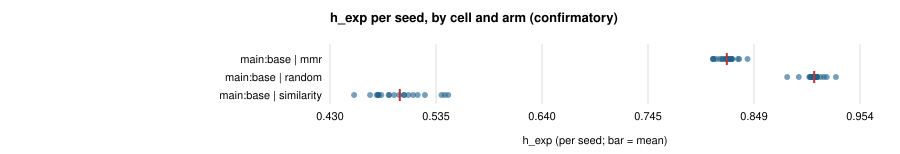

<!-- SPDX-License-Identifier: LicenseRef-PULSE-NC-Research-1.0 -->
# EXP-004 result set report (generated)

Label: ['confirmatory']

Generated by `pulse.report` from 60 validated result files. Git revision at run time: f1838f3e8451c8c4275579a5736fe488354a8f3a (dirty: False). Experiment config hash: 43afda057c89f26add143561edbc0b0033de19675b8b5ef1626103518cdba9b2.

## Execution

- Runs: 60; failed: 0.
- Wall clock for the set: 72.447 s.
- Runtime per run: mean 1.190 s, min 0.805 s, max 1.841 s.
- Platform: macOS-15.3.1-arm64-arm-64bit; CPU: Apple M1 Pro; Python 3.12.1; numpy 2.3.5.

## Per-arm summary (mean over seeds)

H_exp: final-window normalised exposure topic entropy; Gini: item exposure concentration; rel.: mean true utility of examined items; like: observed like rate; ctrl: user-control metric; dH_pref: normalised preference-entropy change (drifting model only).

| cell | arm | n | H_exp | H_exp SD | Gini | rel. | like | ctrl | dH_pref |
| --- | --- | --- | --- | --- | --- | --- | --- | --- | --- |
| main:base | mmr | 20 | 0.8224 | 0.0090 | 0.2947 | 0.1313 | 0.6573 | -0.0474 | NA |
| main:base | random | 20 | 0.9088 | 0.0097 | 0.0558 | 0.0932 | 0.5761 | -0.0841 | NA |
| main:base | similarity | 20 | 0.4993 | 0.0257 | 0.2733 | 0.1327 | 0.6589 | -0.0645 | NA |

## Paired contrasts (treatment minus control, paired by seed)

95% t-interval and percentile bootstrap (10,000 resamples) over seeds; d_z = mean / SD of differences; Holm adjustment within each cell and metric family. All metrics are in contrasts.csv. With few seeds these intervals are wide and only indicate scale.

| cell | metric | contrast | n | mean | SD | 95% t CI | 95% boot CI | d_z | p Holm |
| --- | --- | --- | --- | --- | --- | --- | --- | --- | --- |
| main:base | h_exp | mmr - random | 20 | -0.0864 | 0.0100 | [-0.0911, -0.0817] | [-0.0908, -0.0821] | -8.6179 | 0.0000 |
| main:base | h_exp | similarity - random | 20 | -0.4095 | 0.0246 | [-0.4210, -0.3980] | [-0.4198, -0.3987] | -16.6430 | 0.0000 |
| main:base | h_exp | mmr - similarity | 20 | 0.3230 | 0.0207 | [0.3134, 0.3327] | [0.3142, 0.3317] | 15.6286 | 0.0000 |

